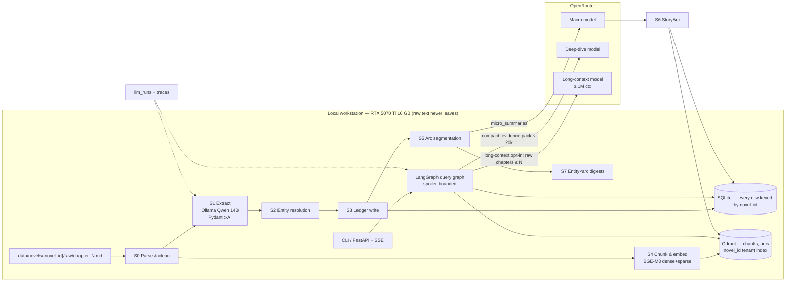
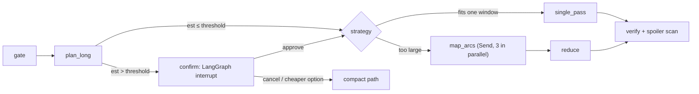

# XN-Agent — Architecture Blueprint v3.1 (Design baseline for development)

> **Status:** Design approved for build. Supersedes `ARCHITECTURE_BLUEPRINT.md` (v2).
> **Basis:** review of v2 and of the prototype in `src/` (commit `8894ce7`). The prototype is treated as a **spike**: its schemas, config and arc-scoring idea carry forward; its orchestration and storage code is replaced by this design (see §0.2).
> Domain terms (cảnh giới, pháp bảo, Hán-Việt names) are kept in Vietnamese.

| Rev | Date | Change |
|---|---|---|
| 3.0 | 2026-10-30 | Audit of v2 + completed design |
| 3.1 | 2026-10-30 | Owner answers incorporated: RTX 5070 Ti 16 GB, OpenRouter allowed for summaries, spoiler control first-class, multi-novel, `chapter_N.md` source format. All Critical/High findings resolved in design |
| 3.2 | 2026-10-30 | Added long-context deep-dive mode (§3.12): raw chapter text to a long-context cloud model, opt-in per query, cost-confirmed |

## 0. Context

### 0.1 Confirmed requirements

| Field | Value | Status |
|---|---|---|
| Purpose | Analysis system for long Chinese web novels in Vietnamese translation: arc timelines, entity deep-dives (nhân vật, pháp bảo, khôi lỗi/linh thú, công pháp, bí cảnh), factual Q&A, comparisons | Confirmed |
| First corpus | *Phàm Nhân Tu Tiên 1* (`novel_id = pntt1`): 2,673 chapters, ~5.6M words → avg ≈ 2,100 words ≈ 11–12k chars ≈ 3–3.5k Qwen tokens/chapter | Confirmed |
| Multi-novel | **Yes** — more novels later; isolation by `novel_id` everywhere | Confirmed |
| Source format | Vietnamese Markdown, one file per chapter: `chapter_<N>.md` | Confirmed |
| Spoiler control | **First-class**: every answer bounded by "as of chapter N" | Confirmed |
| Users | 1 (owner), local CLI first, optional local web UI | Assumed (A-01) |
| Hardware | Windows workstation, **RTX 5070 Ti 16 GB VRAM**, Docker Desktop, Ollama native | Confirmed |
| Data boundary | Extraction and summarization run locally. **Compact mode** (default) sends only summaries, extracted events and short retrieved chunks (≤ 450 tokens). **Long-context mode** (opt-in per deep-dive) may send raw text of selected chapters ≤ N for one entity | Confirmed |
| Fixed decisions | LangGraph (query orchestration), Pydantic-AI (typed agents), Ollama local extraction, OpenRouter macro models, SQLite, Qdrant | Confirmed |

### 0.2 Prototype disposition

| Prototype file | Decision |
|---|---|
| `schemas/extraction.py`, `lifecycle.py`, `arc.py` | Evolve into v3 schemas (§3.2) — add event type, evidence, `novel_id` |
| `timeline/arc_detector.py` | Keep scoring idea; replace greedy segmentation with smoothed DP (§3.2 S5) |
| `configs/config.yaml` | Split into global config + per-novel + genre profile files (§3.11) |
| `agents/graph_workflow.py`, `cli.py` ingest loop, `storage/*` | Replace (findings G-01–G-03, G-12) |
| `docker-compose.yml` | Keep Qdrant (upgrade), remove Redis |

---

## Phase 1 — Audit & resolution

Every finding is resolved in this design or recorded as an accepted risk. "Where" points to the section that resolves it.

| ID | Area | Finding (v2 design / prototype) | Sev | Resolution | Where |
|---|---|---|---|---|---|
| G-01 | Grounding | Timeline path calls the LLM with the raw query and no retrieval; deep-dive falls back to "tri thức nền tảng" → answers come from model memory | **Critical** | Evidence-only answering: retrieve → sufficiency gate → synthesize with citations → code-verified citations. No memory fallback | §3.3, ADR-01 |
| G-02 | Routing | Full query used as entity name; ledger lookup can never match | **Critical** | LLM router extracts mentions → deterministic alias resolver returns entity IDs | §3.3 |
| G-03 | Data integrity | Re-runs duplicate ledger rows; no unique key; no per-chapter transaction | **Critical** | Stage/job model, per-chapter transactions, unique keys, deterministic Qdrant IDs | §3.2 |
| G-04 | Data model | No event type in extraction; every event stored as `CLASH` | **Critical** | `EntityEvent.event_type` + holder + evidence quote | §3.2 |
| G-20 | Spoiler control | Arc summaries, entity digests, merged aliases and the cloud model's own knowledge of the novel all leak content past chapter N | **Critical** (now a requirement) | 6-layer spoiler control: query filters, prefix-safe arcs/digests, time-aware identity links, prompt rule, deterministic leak scan, spoiler eval set with zero-leak gate | §3.4 |
| G-05 | Entity resolution | No canonical entities/aliases; substring `LIKE` both misses variants and over-matches | High | Canonical entities + alias table + fuzzy + LLM adjudication + seed aliases per novel | §3.2 S2 |
| G-06 | Context window | `text[:9000]` drops ~20–25% of a chapter; Ollama default `num_ctx` may truncate the prompt from the start | High | Token-budgeted extraction, 2-part split for long chapters, Modelfile with explicit `num_ctx`, sized for 16 GB | §3.2 S1, §3.9 |
| G-07 | Context budget | Deep-dive concatenates all ledger rows (protagonist → 50k–300k tokens) | High | Entity×arc digests + ranked top-k events; hard 20k-token evidence budget | §3.3 |
| G-08 | Design vs prototype | Arc detection/synthesis, Qdrant writes, embeddings, sparse vectors, checkpointer, Redis, FastAPI, `DEEP_DIVE_MODEL` described but never wired | High | Every component has a stage or node with an owner sprint; Redis removed | §3, Phase 4 |
| G-09 | Dependencies | Prototype uses superseded Pydantic-AI API (`result_type`, `.data`, `OpenAIModel(base_url=)`); unpinned | High | Current API + exact pins via `uv.lock` | §3.3, §3.9 |
| G-21 | Multi-novel | Single-novel schema and collections (`pntt_*`), xianxia-only taxonomy hardcoded | High (now a requirement) | `novel_id` in every key, tenant-indexed Qdrant collections, enforced repository filter, genre profiles + per-novel config | §3.11 |
| G-10 | Chapter identity | `chapter_id` = position in `sorted(glob)` → `chapter_10` sorts before `chapter_2` | Med | Parse `N` from `chapter_<N>.md`, numeric sort, contiguity check | §3.2 S0 |
| G-11 | Arc detection | Greedy threshold on noisy booleans; `max_arc_length` unused | Med | Smoothed score + constrained DP + LLM boundary review; boundary F1 gate | §3.2 S5 |
| G-12 | Robustness | Sync HTTP in async graph; no retries; clients connect at import | Med | Async Pydantic-AI calls with retry policy; lazy client factories | §3.3 |
| G-13 | LLMOps | No run logging or prompt versioning | Med | `llm_runs`, versioned prompt files, tracing | §3.5, §3.8 |
| G-14 | Evaluation | No gold set or thresholds | Med | Gold set + thresholds + regression gate | §3.8 |
| G-15 | Source hygiene | Scraped text noise / injected strings; Markdown syntax in source | Med | S0 Markdown-to-text + cleaning rules per novel | §3.2 S0 |
| G-19 | Throughput | Sequential, unresumable except at extraction level | Med | Job table per (novel, chapter, stage), 2-slot concurrency sized to VRAM | §3.2, §3.9 |
| G-17 | Data egress | No explicit rule on what leaves the machine | Low | Code-enforced egress rule; OpenRouter no-training providers | §3.7 |
| G-18 | Engineering | No tests/CI/lockfile; **no `.gitignore` (`.env` with API key would be committed)** | Low → fix in Sprint 1, day 1 | `.gitignore`, `uv`, CI with offline agent tests | §3.9 |

OWASP LLM Top 10: LLM01 → G-15 · LLM02 → G-17 · LLM09 → G-01, G-02, G-07, G-20 · LLM10 → G-07.

---

## Phase 2 — Optimizations to existing elements

| v2 element | v3 design | Gaps | Impact (est.) | Trade-off |
|---|---|---|---|---|
| Keyword router, query as entity | Pydantic-AI router on local Qwen (`RouterDecision`) + deterministic resolver | G-02, G-05 | Entity hit rate → resolver recall (target ≥ 0.90) | +0.5–1.5 s per query |
| Raw-HTTP timeline node | Retrieval → typed synthesizer with citations | G-01, G-12 | Grounded, spoiler-bounded answers | ~6–15k input tokens/answer |
| `text[:9000]` | Token budget + 2-part split; `num_ctx 12288`, KV cache q8_0 | G-06 | 0% truncation | ~+8% extraction time |
| All ledger rows to LLM | Entity×arc digests + top-k events, 20k cap | G-07 | Bounded cost/latency for any entity | Precompute stage S7 |
| `CLASH` everywhere | Typed events, evidence quotes, unique keys | G-03, G-04 | Lifecycle questions answerable; idempotent | +~150 output tokens/chapter |
| Dense 1024 with no model | BGE-M3 dense+sparse, RRF, bge-reranker-v2-m3 | G-08 | Real hybrid search; exact Hán-Việt name matching | Shares GPU → separate stage |
| Greedy changepoint | Smoothed constrained DP + LLM review | G-11 | Boundary F1 ≥ 0.80 target | ~45 extra calls/novel |
| `pntt_*` collections | Shared collections, `novel_id` tenant index | G-21 | Add a novel with zero infra change | Every query must carry `novel_id` (enforced) |
| qwen2.5:14b fixed | Benchmark qwen2.5:14b vs qwen3:14b (non-thinking) on gold set in Sprint 1 | — | Better JSON reliability likely `[verify]` | One eval run |
| Redis | Removed; SQLite for cache/jobs | G-08 | One less service | — |
| LangGraph over batch ingestion | Staged pipeline + job table; LangGraph for queries | G-08, G-19 | Per-stage resume and re-run | Departs from v2 text (ADR-02) |
| Deep-dive from extracted events only | Optional long-context mode reading raw chapters with a ≥ 1M-context model (§3.12) | G-07 | Richer analysis (dialogue, tactics, author intent) that a 14B extractor misses | $0.05–8 per report; minutes of latency |

---

## Phase 3 — Completed Blueprint

### 3.1 System overview



Query path:

```mermaid
sequenceDiagram
  participant U as User
  participant R as route (local)
  participant E as resolve_entities
  participant RT as retrieve (≤ chapter_max)
  participant G as gate
  participant S as synthesize (OpenRouter)
  participant V as verify + spoiler scan
  U->>R: query, novel_id, chapter_max
  R->>E: RouterDecision(intent, mentions, chapter_hint)
  E->>RT: entity_ids (identity links revealed ≤ chapter_max only)
  RT->>G: EvidencePack (all items ≤ chapter_max)
  alt insufficient evidence
    G-->>U: "Không đủ dữ liệu đến chương N" + what was searched
  else
    G->>S: EvidencePack
    S->>V: Answer(markdown, citations)
    V-->>U: streamed answer; invalid citations stripped; leaks redacted or regenerated
  end
```

**NFRs / SLOs**

| Metric | Target |
|---|---|
| Full ingestion of `pntt1` | ≤ 20 h wall clock (est. ~11–17 h, §3.9), resumable per (novel, chapter, stage) |
| Extraction schema success (≤ 3 retries) | ≥ 98% of chapters; failures queued, never silently skipped |
| Query p95 latency | factual QA ≤ 15 s, timeline ≤ 25 s, deep-dive ≤ 45 s; first token ≤ 5 s |
| Long-context deep-dive | plan + estimate ≤ 10 s; single pass ≤ 3 min; map-reduce ≤ 8 min; progress streamed |
| Grounding | ≥ 90% of answer claims carry a valid chapter citation |
| **Spoiler leaks** | **0** on the spoiler eval set (hard gate) |
| Cost | Cloud spend ≤ US$5 per novel ingestion; ≤ US$0.01 per compact query; long-context deep-dive shows an estimate first and requires confirmation above US$0.50 (configurable) `[verify pricing]` |

### 3.2 Data pipeline & RAG

**Stage contract.** Each stage reads/writes SQLite and records `(novel_id, chapter_id, stage, status, input_hash, prompt_version, model, error)` in `jobs`. A stage re-runs only when `input_hash` or `prompt_version` changes. Writes are per-chapter transactions (delete that chapter's rows for the stage, then insert). CLI: `python -m xn run --novel pntt1 --stage s1 --from 1 --to 2673 [--stale-only]`.

| Stage | Design |
|---|---|
| **S0 Parse & clean** | Input dir `data/novels/{novel_id}/raw/`. Accept only files matching `^chapter_(\d+)\.md$`; sort by the **integer** N; fail the run if any number in `1..total_chapters` is missing or duplicated (report list). Title = first Markdown heading `^#{1,3}\s*(.+)$`, else first line matching `^Chương\s+\d+`, else `Chương N`. Convert Markdown → plain text with `markdown-it-py` (drop images/links/HTML, keep paragraph breaks). NFC-normalize. Apply the novel's cleaning rules (`configs/novels/{id}.yaml → cleaning.patterns`) and drop lines that repeat in > 5% of chapters (site watermarks). Store `clean_text`, `sha256`, `token_count` |
| **S1 Extract** | Local Qwen via Pydantic-AI, temperature 0.1, prompt templated with the genre profile (§3.11). Chapter ≤ 7,000 tokens → one call; longer → 2 parts with 300-token overlap, merged in code (union events, OR booleans, local re-summary). Output `ChapterExtraction` (below). Evidence quote check drops unverifiable events |
| **S2 Resolve** | Within one `novel_id` only. (1) exact normalized alias; (2) diacritics-stripped; (3) `rapidfuzz` token_set ≥ 92, same category; (4) 80–92 → local LLM adjudication with both contexts; (5) new entity. Seed aliases from `configs/novels/{id}.yaml`. Records `first_chapter` per entity and per alias. Identity reveals (one person behind two names) go to `entity_links`, never merged (§3.4) |
| **S3 Ledger** | `entity_events` keyed by `entity_id` with unique `(novel_id, chapter_id, entity_id, event_type, ordinal)` |
| **S4 Embed** | Separate GPU window (Ollama unloaded). Paragraph chunks ~450 tokens, 60 overlap (~20k chunks for `pntt1`) + each `micro_summary`. BGE-M3 dense+sparse |
| **S5 Segment** | Score `s_i = Σ w·flag` (weights per novel); centered smoothing window 5; DP picks boundaries maximizing Σ scores subject to `min_len ≤ len ≤ max_len`; LLM reviews each boundary with micro-summaries ±5 chapters and may shift ≤ 5 |
| **S6 Synthesize** | OpenRouter macro model → `StoryArc` from the arc's micro-summaries (~12k tokens in) |
| **S7 Digests** | For each (entity, arc) with ≥ 3 events: 80–150-word digest (local model). Also prefix digests at spoiler checkpoints (§3.4) |

**Extraction schema** (`src/xn/schemas/extraction.py`)

```python
class EntityEvent(BaseModel):
    name: str                                   # surface form as written
    category: str                               # validated against genre profile categories
    event_type: LifecycleEventType              # ACQUISITION | UPGRADE | USED_IN_BATTLE | DAMAGED | TRANSFERRED | DESTROYED | FALLEN_OR_SEALED | REVEALED_IDENTITY | MENTIONED
    holder: Optional[str] = None
    tier_or_realm: Optional[str] = None         # normalized later against the novel's realm ladder
    same_as: Optional[str] = None               # only with REVEALED_IDENTITY: the other name now known to be this entity
    description: str = Field(max_length=400)
    evidence: str = Field(max_length=200, description="≤25-word verbatim quote")

class ChapterExtraction(BaseModel):
    chapter_id: int
    map_location: str
    location_change: bool
    mc_realm: Optional[str]
    realm_breakthrough: bool
    major_conflict: bool
    time_skip_years: float = 0.0
    micro_summary: str = Field(min_length=200, max_length=1200)
    events: list[EntityEvent] = Field(max_length=25)
```

Code-side validators: `category ∈ profile.categories`; each `evidence` fuzzy-matches `clean_text` (partial_ratio ≥ 85) else the event is dropped and logged; `chapter_id` overwritten from S0 (never trusted from the model).

**SQLite schema** (every table carries `novel_id`; `PRAGMA journal_mode=WAL`, `foreign_keys=ON`)

```sql
CREATE TABLE novels (novel_id TEXT PRIMARY KEY, title TEXT NOT NULL, author TEXT, language TEXT DEFAULT 'vi',
  genre_profile TEXT NOT NULL, series_id TEXT, total_chapters INTEGER NOT NULL,
  reader_progress INTEGER, created_at TEXT);
CREATE TABLE chapters (novel_id TEXT REFERENCES novels, chapter_id INTEGER, title TEXT, clean_text TEXT NOT NULL,
  sha256 TEXT NOT NULL, token_count INTEGER, arc_id INTEGER, PRIMARY KEY(novel_id, chapter_id));
CREATE TABLE extractions (novel_id TEXT, chapter_id INTEGER, payload JSON NOT NULL, prompt_version TEXT NOT NULL,
  model TEXT NOT NULL, created_at TEXT, PRIMARY KEY(novel_id, chapter_id),
  FOREIGN KEY(novel_id, chapter_id) REFERENCES chapters);
CREATE TABLE entities (novel_id TEXT REFERENCES novels, entity_id INTEGER, canonical_name TEXT NOT NULL,
  category TEXT NOT NULL, first_chapter INTEGER NOT NULL, last_chapter INTEGER, mention_count INTEGER DEFAULT 0,
  PRIMARY KEY(novel_id, entity_id), UNIQUE(novel_id, canonical_name, category));
CREATE TABLE entity_aliases (novel_id TEXT, alias_norm TEXT, entity_id INTEGER, first_chapter INTEGER NOT NULL,
  source TEXT CHECK (source IN ('seed','exact','fuzzy','llm')), PRIMARY KEY(novel_id, alias_norm, entity_id));
CREATE TABLE entity_links (novel_id TEXT, entity_a INTEGER, entity_b INTEGER, relation TEXT DEFAULT 'same_identity',
  revealed_chapter INTEGER NOT NULL, evidence TEXT, PRIMARY KEY(novel_id, entity_a, entity_b));
CREATE TABLE entity_events (novel_id TEXT, id INTEGER, chapter_id INTEGER NOT NULL, entity_id INTEGER NOT NULL,
  event_type TEXT NOT NULL, ordinal INTEGER NOT NULL, holder_entity_id INTEGER, tier_or_realm TEXT,
  realm_rank INTEGER, description TEXT NOT NULL, evidence TEXT, PRIMARY KEY(novel_id, id),
  UNIQUE(novel_id, chapter_id, entity_id, event_type, ordinal));
CREATE INDEX ix_events_entity ON entity_events(novel_id, entity_id, chapter_id);
CREATE TABLE arcs (novel_id TEXT, arc_id INTEGER, start_chapter INTEGER, end_chapter INTEGER, payload JSON,
  prompt_version TEXT, model TEXT, PRIMARY KEY(novel_id, arc_id));
CREATE TABLE entity_arc_digests (novel_id TEXT, entity_id INTEGER, arc_id INTEGER, upto_chapter INTEGER,
  digest TEXT, event_count INTEGER, PRIMARY KEY(novel_id, entity_id, arc_id, upto_chapter));
CREATE TABLE arc_prefix_summaries (novel_id TEXT, arc_id INTEGER, upto_chapter INTEGER, summary TEXT,
  PRIMARY KEY(novel_id, arc_id, upto_chapter));
CREATE TABLE jobs (novel_id TEXT, chapter_id INTEGER, stage TEXT, status TEXT
  CHECK (status IN ('pending','running','done','failed')), input_hash TEXT, prompt_version TEXT, model TEXT,
  attempts INTEGER DEFAULT 0, error TEXT, updated_at TEXT, PRIMARY KEY(novel_id, chapter_id, stage));
CREATE TABLE llm_runs (run_id TEXT PRIMARY KEY, novel_id TEXT, stage TEXT, chapter_id INTEGER, model TEXT,
  prompt_version TEXT, input_tokens INTEGER, output_tokens INTEGER, latency_ms INTEGER, retries INTEGER,
  ok INTEGER, cost_usd REAL, egress_class TEXT CHECK (egress_class IN ('local','compact','long_context')),
  payload_chapters TEXT, created_at TEXT);
CREATE TABLE answer_cache (novel_id TEXT, cache_key TEXT, chapter_max INTEGER, answer JSON, created_at TEXT,
  PRIMARY KEY(novel_id, cache_key));
CREATE TABLE lc_map_cache (novel_id TEXT, entity_id INTEGER, arc_id INTEGER, upto_chapter INTEGER,
  prompt_version TEXT, model TEXT, payload JSON, input_tokens INTEGER,
  PRIMARY KEY(novel_id, entity_id, arc_id, upto_chapter, prompt_version, model));
CREATE TABLE feedback (run_id TEXT, rating INTEGER, note TEXT, created_at TEXT);
```

(`arc_id` is the full-arc row; `upto_chapter = end_chapter` for full digests.)

**Qdrant collections** (shared across novels)

| Collection | Vectors | Payload indexes |
|---|---|---|
| `xn_chunks` | `dense` 1024 cosine, `sparse` (BGE-M3 lexical) | `novel_id` keyword (**tenant**), `chapter_id` int (range), `arc_id` int, `kind` (`text`/`summary`), `entity_ids` int[] |
| `xn_arcs` | `dense` 1024 | `novel_id` (**tenant**), `arc_id`, `start_chapter`, `end_chapter` |

Point ID = `uuid5(NAMESPACE, f"{novel_id}:{kind}:{chapter_id}:{chunk_no}")` → re-embedding upserts, never duplicates.

**Retrieval**: Qdrant query API, `prefetch` dense k=40 + sparse k=40 → RRF → mandatory filter `novel_id == X AND chapter_id <= chapter_max` → rerank top-30 with bge-reranker-v2-m3 → top-8 (~3.6k tokens).

### 3.3 Orchestration

Ingestion = staged pipeline (`src/xn/pipeline/`). Queries = LangGraph.

```python
class QueryState(TypedDict, total=False):
    novel_id: str                     # from CLI/session — never inferred by the LLM
    chapter_max: int                  # resolved spoiler bound (§3.4)
    mode: Literal["compact", "long_context"]   # user-chosen; default compact
    lc_plan: LongContextPlan          # §3.12
    query: str
    thread_id: str
    decision: RouterDecision
    entity_ids: list[int]
    unresolved_mentions: list[str]
    evidence: EvidencePack            # every item carries chapter_id ≤ chapter_max
    answer: Answer                    # markdown + citations
    leak_report: LeakReport
    errors: Annotated[list[str], operator.add]

class RouterDecision(BaseModel):
    intent: Literal["timeline", "deep_dive", "factual_qa", "compare"]
    mentions: list[str] = Field(max_length=4)
    chapter_hint: Optional[int] = None   # "đến chương 800" in the question
    aspect: Optional[str] = None
```

| Node | Implementation |
|---|---|
| `route` | Pydantic-AI on local Qwen, `output_type=RouterDecision`, few-shot prompt; on failure → `factual_qa` with no mentions |
| `bound` | Code: `chapter_max = min(explicit param or chapter_hint or novels.reader_progress or total_chapters, total_chapters)` (§3.4) |
| `resolve_entities` | Code against `entity_aliases` where `first_chapter ≤ chapter_max`; identity links applied only if `revealed_chapter ≤ chapter_max`. Unresolved → top-3 fuzzy suggestions |
| `retrieve` | **timeline** → arcs fully ≤ N + prefix summary of the current arc + top chunks; **deep_dive** → entity×arc digests (prefix-safe) + top-25 events ranked by type (ACQUISITION, UPGRADE, DESTROYED, TRANSFERRED, REVEALED_IDENTITY first) + top-8 entity-filtered chunks; **compare** → deep_dive per entity at half budget; **factual_qa** → hybrid chunks. Hard budget 20k tokens; lowest-ranked items dropped first |
| `gate` | deep_dive: ≥ 1 resolved entity and ≥ 3 events; others: top reranker score ≥ 0.3. Else answer "Không đủ dữ liệu đến chương N" — no memory fallback |
| `synthesize` | Pydantic-AI on OpenRouter (`MACRO_MODEL` for timeline/QA, `DEEP_DIVE_MODEL` for deep_dive/compare); `output_type=Answer`; streamed |
| `verify` | Code: citations must exist in the evidence pack and be ≤ N; spoiler scan (§3.4 L5); grounding ratio logged |

`deep_dive` and `compare` with `mode=long_context` leave the compact path after `gate` and enter the long-context subgraph (§3.12). The router can *suggest* long-context mode ("analyze X through the whole story"), but only the user switches it on.

Compiled with `SqliteSaver` (`data/graph_checkpoints.db`), `thread_id` per conversation; a follow-up inherits `novel_id` and `chapter_max` from the thread. OpenRouter calls: timeout 90 s, 3 retries with exponential backoff on 429/5xx, then the configured fallback model. Clients are created by factories on first use (no import-time connections).

Model setup (current Pydantic-AI API — confirm names against the pinned version):

```python
from pydantic_ai import Agent
from pydantic_ai.models.openai import OpenAIChatModel
from pydantic_ai.providers.openai import OpenAIProvider

local = OpenAIChatModel(cfg.ollama_model, provider=OpenAIProvider(base_url=cfg.ollama_base_url, api_key="ollama"))
macro = OpenAIChatModel(cfg.macro_model, provider=OpenAIProvider(base_url=cfg.openrouter_base_url,
                                                                 api_key=cfg.openrouter_api_key.get_secret_value()))
extractor = Agent(local, output_type=ChapterExtraction, retries=3, model_settings={"temperature": 0.1})
# result = await extractor.run(prompt); result.output
```

### 3.4 Spoiler control (first-class)  *(G-20)*

**Rule:** for a query bounded at chapter N, no information that first appears after chapter N may reach the answer.

**Resolving N**: explicit `--until N` / API `chapter_max` → else number in the question ("đến chương 800") → else `novels.reader_progress` (set with `xn progress pntt1 1200`) → else `total_chapters`. `--full` removes the bound explicitly. The resolved N is printed with every answer ("Phạm vi: chương 1–1200").

| Layer | Leak source | Control |
|---|---|---|
| L1 Filters | Events, chunks, arcs after N | Repository layer requires `chapter_max`; every SQL query adds `chapter_id <= :n`; every Qdrant query adds the range filter. Unit test asserts no repository method accepts a missing bound |
| L2 Arc summaries | A full `StoryArc` summary describes the arc's ending | Use the full summary only if `end_chapter ≤ N`. For the arc containing N, use an **arc prefix summary** built from micro-summaries `start..N` (local model, cached in `arc_prefix_summaries`). Precompute prefixes every 10 chapters; snap N down to the nearest checkpoint, then append raw micro-summaries for the remainder |
| L3 Entity digests | Entity×arc digest covers the whole arc | Same rule: full digest only if the arc ends ≤ N; otherwise prefix digest (`upto_chapter`) built from events ≤ N |
| L4 Identity & names | Merged aliases reveal hidden identities; canonical names may be a later title | Identities stay separate entities joined by `entity_links.revealed_chapter`. Joined only when `revealed_chapter ≤ N`. Display name = the most frequent alias with `first_chapter ≤ N`; realm shown = last `realm_rank` ≤ N |
| L5 Model knowledge | Cloud models may know the novel and add later events | Synthesizer instruction: use only the evidence pack; never mention events, names or realms not in it. **Deterministic scan** after generation: match answer text against all aliases with `first_chapter > N` and realm names above the max `realm_rank` seen ≤ N for mentioned entities. On a hit → regenerate once with the offending terms listed as forbidden → if it still leaks, redact the sentence and mark "[đã ẩn để tránh tiết lộ]" |
| L6 Caching & threads | A cached answer for a larger N reused for a smaller N | `answer_cache` key includes N; thread state pins N; changing N in a thread starts a new branch |

The spoiler eval set (§3.8) gates releases: **0 leaks** required.

Known limitation (accepted risk R-01): a leak paraphrased without any future name or realm (e.g. "người này sau này sẽ phản bội") is not caught by L5. The prompt rule and the spoiler eval set mitigate it, but it isn't guaranteed.

### 3.5 Prompt management

- Prompts live in `prompts/<name>/<version>.md` with front matter (`name`, `version`, `model_family`, `output_schema`, `genre_profiles`, `changelog`). Jinja2 placeholders for genre-profile content (categories, event definitions, realm ladder). No prompt strings in Python.
- `load_prompt(name, version, profile)` returns rendered text + `sha256[:8]` of the template; the hash goes to `llm_runs.prompt_version` and `jobs.prompt_version`.
- Active versions pinned in `configs/config.yaml → prompts:`; a per-novel override is allowed (`configs/novels/{id}.yaml → prompts:`).
- Changing a version marks affected jobs stale → `xn run --stage s1 --stale-only`.
- Regression gate: `pytest tests/eval -m gold --novel pntt1` fails if any metric drops > 2 points vs `eval/{novel_id}/baseline.json`.

### 3.6 API & frontend

CLI is primary. FastAPI exposes the same functions, bound to `127.0.0.1`. All routes are novel-scoped.

| Method | Path | Purpose |
|---|---|---|
| GET | `/v1/novels` | List novels with ingestion status and `reader_progress` |
| PUT | `/v1/novels/{novel_id}/progress` | Set reading progress (default spoiler bound) |
| POST | `/v1/novels/{novel_id}/query` | Run query graph; `Accept: text/event-stream` → SSE |
| POST | `/v1/novels/{novel_id}/query/{thread_id}/resume` | Approve or cancel a long-context plan `{approve: bool, budget_usd?: number}` |
| GET | `/v1/novels/{novel_id}/entities?q=&until=` | Alias search, spoiler-bounded |
| GET | `/v1/novels/{novel_id}/entities/{id}/timeline?until=` | Ledger events, paginated |
| GET | `/v1/novels/{novel_id}/arcs?until=` | Arcs (prefix view for the current arc) |
| POST | `/v1/novels/{novel_id}/pipeline/runs` | Start a stage run `{stage, from, to, stale_only}` (single-flight per novel+stage) |
| GET | `/v1/pipeline/runs/{run_id}` | Progress by status |

```json
// POST /v1/novels/pntt1/query
{ "query": "Thanh Trúc Phong Vân Kiếm tiến hóa thế nào?", "thread_id": "t-01", "chapter_max": 1200, "mode": "long_context" }

// SSE
event: status  data: {"node":"retrieve","chapter_max":1200,"entities":[{"id":42,"name":"Thanh Trúc Phong Vân Kiếm"}]}
event: plan    data: {"strategy":"map_reduce","chapters":214,"batches":9,"input_tokens":1240000,"est_cost_usd":0.41,"needs_approval":false}
event: progress data: {"batch":3,"of":9,"arc":"Loạn Tinh Hải"}
event: token   data: {"text":"..."}
event: done    data: {"citations":[211,214,388],"grounding_ratio":0.93,"spoiler_scan":"clean",
                      "tokens":{"in":14210,"out":1180},"cost_usd":0.006}
event: error   data: {"code":"INSUFFICIENT_EVIDENCE","message":"...","suggestions":["Thanh Trúc kiếm"]}
```

Error codes: `NOVEL_NOT_FOUND`, `NOVEL_NOT_INGESTED`, `ENTITY_NOT_FOUND`, `INSUFFICIENT_EVIDENCE`, `UPSTREAM_TIMEOUT`, `UPSTREAM_RATE_LIMIT`, `VALIDATION_FAILED`. Auth: none on localhost; `X-API-Key` if ever exposed on the LAN.

**Frontend (optional, Sprint 4)**: CLI with `rich` live rendering first. Optional local web UI on the SSE contract: novel picker; **reading-progress slider** shown on every screen; streamed answer with clickable chapter citations → evidence quote panel; "did you mean" chips; 👍/👎 feedback into `feedback`.

### 3.7 Security, guardrails & compliance

| Risk | Control |
|---|---|
| Hallucination | Evidence-only synthesis; `gate` refuses without evidence; citations verified in code; grounding ratio logged |
| Spoilers | §3.4 (L1–L6) |
| Injected text in source (LLM01) | S0 cleaning; chapter text wrapped in `<chapter>` tags declared as data; schema-bound output, no tools in extraction |
| Egress / copyright (LLM02) | Code rule in the OpenRouter client wrapper with two egress classes. **compact**: micro-summaries, digests, events and ≤ 8 retrieved chunks of ≤ 450 tokens. **long_context** (explicit opt-in per query): raw text of chapters ≤ N selected for one entity, within the approved plan's token budget; never the whole book in one request. Every request's chapter list is written to `llm_runs.payload_chapters`. OpenRouter account restricted to providers that don't train on prompts `[verify setting]`. Personal use; extracted corpora not published |
| Secrets | `.gitignore` for `.env`, `data/`, `*.db`, `qdrant_storage/`; `SecretStr`; keys never logged |
| Cross-novel bleed | Repository layer requires `novel_id`; Qdrant filter enforced; test asserts a query on novel A never returns novel B IDs |
| Unbounded consumption (LLM10) | 20k-token evidence budget; `max_tokens=2500`; daily spend cap checked against `llm_runs.cost_usd` |
| Bad extractions | Evidence-quote check, enum/profile validation, list size limits |

### 3.8 Observability & evaluation

**Tracing**: Pydantic-AI OpenTelemetry instrumentation → self-hosted Langfuse (Docker) or Logfire `[verify current API]`; LangGraph nodes as spans tagged `novel_id`, `chapter_max`, `thread_id`. Every LLM call also writes `llm_runs` (works offline).

**SQL views**: schema-retry rate per prompt version; failed chapters per novel; tokens & cost per stage; p50/p95 per node; grounding ratio; spoiler-scan hits (regenerations, redactions).

**Gold set per novel** (`eval/{novel_id}/`, ~8 hours of manual work for `pntt1`)

| Asset | Size | Metric | Threshold |
|---|---|---|---|
| Annotated chapters (spread across the book) | 40 | Entity recall / precision | ≥ 0.85 / ≥ 0.90 |
| | | Event-type accuracy | ≥ 0.75 |
| | | Flag F1 (location change, breakthrough, conflict) | ≥ 0.80 |
| Alias pairs (same / different) | 150 | Resolver pairwise F1 | ≥ 0.90 |
| Arc boundaries | all annotated | Boundary F1 (±3 chapters) | ≥ 0.80 |
| Q&A with answer chapters | 40 | RAGAS faithfulness / context recall; citation hit rate | ≥ 0.85 / ≥ 0.80 / ≥ 0.80 |
| **Spoiler probes** (question + N + forbidden facts/names) | 30 | Leaks | **0** |
| Long-context deep-dives (entities of different frequency: protagonist, major pháp bảo, minor item) | 10 | Pairwise judge vs compact mode; citation validity; quote accuracy | Long-context preferred ≥ 60%; citations ≥ 95% valid; quotes ≥ 95% verbatim |

Spoiler probes target the known leak sources: hidden identities, items destroyed/transferred later, realm breakthroughs just after N, arcs straddling N. RAGAS evaluator = OpenRouter macro model. Eval runs on demand, not in CI.

### 3.9 Infrastructure & deployment

**GPU plan — RTX 5070 Ti 16 GB**

| Mode | Resident on GPU | Est. VRAM |
|---|---|---|
| Ingestion S1/S2/S7 | Qwen 14B Q4_K_M (~9.0 GB) + KV cache q8_0, `num_ctx 12288` × 2 slots (~2.3 GB) + buffers (~0.8 GB) | ≈ 12.1 GB (+ ~1 GB Windows desktop) |
| Ingestion S4 | Ollama unloaded (`ollama stop`); BGE-M3 fp16 + batch activations | ≈ 4–5 GB |
| Query time | Qwen 14B (router) + bge-reranker-v2-m3 fp16 (~1.2 GB); BGE-M3 **query** encoding on CPU (~0.3 s) | ≈ 13 GB |

KV estimate for Qwen2.5-14B (48 layers × 8 KV heads × 128 dim): ~0.19 MB/token fp16, ~0.09 MB/token q8_0. Qwen3-14B is smaller (40 layers) `[verify]`.

Ollama setup:
```
# ollama/Modelfile.qwen14b-12k
FROM qwen2.5:14b            # or qwen3:14b after the Sprint 1 benchmark
PARAMETER num_ctx 12288
PARAMETER temperature 0.1
```
Environment: `OLLAMA_FLASH_ATTENTION=1`, `OLLAMA_KV_CACHE_TYPE=q8_0`, `OLLAMA_NUM_PARALLEL=2`, `OLLAMA_KEEP_ALIVE=30m`. Why 12,288: system + schema ≈ 1.2k, chapter ≤ 7k (longer chapters are split), output ≤ 1.5k → ~9.7k with headroom. If VRAM pressure appears, use `NUM_PARALLEL=1` first, then `num_ctx 10240`.

Blackwell note: PyTorch for BGE-M3/reranker must be a CUDA 12.8+ build that supports sm_120 `[verify current wheel]`; Ollama ships its own runtime.

**Services** (`docker-compose.yml`): Qdrant at a current 1.x with query API, sparse vectors and tenant indexes `[verify version at pin time]`; optional Langfuse. Redis removed.

**Repo layout**
```
configs/config.yaml               # global: models, prompts, budgets
configs/genres/xianxia.yaml       # categories, event definitions, extraction hints
configs/novels/pntt1.yaml         # title, total_chapters, realm ladder, arc params, aliases seed, cleaning rules
data/novels/pntt1/raw/chapter_N.md
prompts/<name>/<version>.md
src/xn/{schemas,pipeline,storage,graph,api,cli}/
eval/pntt1/{gold,baseline.json}
```

**Python & CI**: `uv` + `pyproject.toml` + `uv.lock` with exact pins. GitHub Actions: `ruff`, `mypy --strict src/`, `pytest` (unit, repository bound/tenant tests, agent tests with Pydantic-AI `TestModel`/`FunctionModel` — no network), schema snapshot tests.

**Caching**: `answer_cache` keyed by `(novel_id, normalized_query, chapter_max, prompt_versions, data_version)`. No semantic cache (single user). **Backup**: copy `data/*.db` + Qdrant snapshot after each completed stage.

**Time & cost model for `pntt1`** (5070 Ti estimates — measure in Sprint 1: ~2,500 tok/s prefill, ~50 tok/s decode for 14B Q4; DeepSeek-class pricing ≈ $0.3/M in, $1.1/M out `[verify]`)

| Item | Formula | Estimate |
|---|---|---|
| S1 extraction | 2,673 × (4.7k/2500 + 900/50) s × 1.15 | ≈ 17 h sequential; ≈ 11 h with 2 slots |
| S2 adjudication + S7 digests | local | ≈ 2–3 h |
| S4 embedding | ~23k items @ ~60/s | ≈ 7 min |
| Arc prefix summaries (every 10 ch.) | ~267 × local call | ≈ 1.5 h |
| S6 arc synthesis | ~45 × (13k in + 1.5k out) | ≈ $0.25 |
| Per query (compact) | ≤ 20k in + ≤ 2.5k out (+1 regeneration if leak) | ≤ $0.01–0.02 |
| Long-context, minor/major item (single pass) | 50–250k in + ~4k out | ≈ $0.02–0.10 DeepSeek-class; ≈ $0.20–1.00 top-tier |
| Long-context, protagonist at N = 2,673 (map-reduce) | ~1.2–2M in + ~60k out | ≈ $0.40–0.70 DeepSeek-class; ≈ $5–8 top-tier; reruns mostly hit `lc_map_cache` |

### 3.10 Failure modes

| Failure | Detection | Mitigation | User-facing behavior |
|---|---|---|---|
| Missing/duplicate `chapter_N.md` | S0 contiguity check | Run aborts with the list | Clear error before any LLM spend |
| Extraction fails after 3 retries | `jobs.status=failed` | Retry with split strategy, then manual queue | `xn status` lists it; answers note "chương N chưa được xử lý" if in range |
| Ollama OOM / crash | Connection error, VRAM log | Resume from `jobs`; auto-drop to 1 slot | Run continues after restart |
| Entity split across IDs | `xn entities suspect` (high-similarity pairs) | `xn entities merge A B` | Incomplete timeline until merged |
| Wrong merge | Category clash, contradictory holders | `xn entities split` by chapter range | Mixed timeline |
| Identity revealed but not detected | Spoiler/alias eval | Manual `entity_links` entry in novel config | Two separate timelines |
| OpenRouter 429/5xx | Exceptions | Backoff ×3 → fallback model | Slower answer or `UPSTREAM_*` |
| Spoiler leak detected | L5 scan | Regenerate once → redact sentence | Possible "[đã ẩn…]" marker |
| Evidence over budget | Token counter | Drop lowest-ranked items | None (logged) |
| Invented chapter numbers | `verify` | Strip, lower grounding score | Unverified claims marked |
| Qdrant down | Startup health check | Ledger-only deep-dive; QA fails gracefully | Warning |
| Long-context request exceeds model window | Token count vs model `context_length` | Re-pack into more batches | Slightly longer run |
| Long-context plan over budget | Planner estimate | Pause for approval; offer cheaper options (fewer chapters, excerpt-only, compact mode) | Approval prompt |
| One map batch fails | Exception after retries | Retry batch; reduce with remaining batches and list missing arcs | Report marks "thiếu phân tích arc X" |
| Query without `novel_id` / bound | Repository guard | Raise before I/O | `NOVEL_NOT_FOUND` / programming error in tests |

### 3.11 Multi-novel design  *(G-21)*

- **Identity**: `novel_id` slug (`pntt1`, later e.g. `pntt2`). It is part of every SQLite primary key, every Qdrant payload, every job, cache entry, eval folder and log span.
- **Isolation**: single shared Qdrant collections with `novel_id` as a tenant payload index (efficient for many small tenants, no per-novel infra); the repository layer refuses any read without `novel_id`.
- **Genre profile** (`configs/genres/<genre>.yaml`): entity categories, event-type definitions with examples, extraction hints. `xianxia` ships first. The schema enum `LifecycleEventType` is a fixed superset; categories are validated against the profile, so a new genre needs config + prompt review, not code changes.
- **Per-novel config** (`configs/novels/<id>.yaml`): title, author, `total_chapters`, genre profile, **realm ladder** (ordered list → `realm_rank`, used for power progression and spoiler checks), arc weights/min/max length, seed aliases and identity links, cleaning patterns, optional prompt overrides.
- **Series**: `novels.series_id` reserved. Cross-novel entity linking (sequels sharing characters) is out of scope for v3 — see R-03.
- **Onboarding a novel**: add config + raw files → `xn novel add <id>` → `xn run --novel <id> --all` → annotate a small gold set (≥ 15 chapters, 10 spoiler probes) before trusting answers.

### 3.12 Long-context deep-dive mode

**Purpose.** Compact mode reasons over extracted events and digests, which miss what a 14B extractor drops: dialogue, battle tactics, foreshadowing, how the author frames an item. Long-context mode lets a strong cloud model read the **raw chapters** about one entity, still spoiler-bounded and cited.

**Trigger.** `xn ask --novel pntt1 --mode long "Phân tích Thanh Trúc Phong Vân Kiếm xuyên suốt truyện"` or API `mode: "long_context"`. Applies to `deep_dive` and `compare` (one plan per entity).

**Model.** `LONG_CONTEXT_MODEL` in config: an OpenRouter model with a ≥ 1M-token window `[verify current choice and pricing at pin time]`. The planner reads `context_length` and pricing from OpenRouter's model list at startup and caches them, so the model can change without code changes. Usable budget per request = 70% of `context_length` (headroom for instructions, index and output).

**Subgraph**



**plan_long (code, no LLM)**
1. Collect the entity's events with `chapter_id ≤ N` (after identity links valid at N).
2. Rank chapters: **key** = chapters with ACQUISITION, UPGRADE, DAMAGED, TRANSFERRED, DESTROYED, FALLEN_OR_SEALED, REVEALED_IDENTITY, or USED_IN_BATTLE inside a `major_conflict` chapter; **supporting** = other mentions.
3. Pack text: key chapters as **full text**; supporting chapters as **excerpts** = paragraphs mentioning any alias valid at N, ±2 paragraphs. Typical sizes: full ≈ 3.3k tokens, excerpt ≈ 300–600 tokens.
4. Decide strategy: total ≤ budget → `single_pass`; else `map_reduce` with batches aligned to arcs (an arc split only if it alone exceeds the budget). If even key chapters exceed ~2.5M tokens (protagonist case), keep key chapters at full text only for the top-weighted events per arc and turn the rest into excerpts.
5. Estimate tokens and cost from cached pricing; check `lc_map_cache` hits (cached batches cost $0).
6. Emit a `plan` event. If `est_cost_usd > long_context.approval_threshold_usd` (default 0.50) → `interrupt()` and wait for `resume {approve}`. CLI shows the plan and asks `[y/N]`; `--yes` skips the prompt up to `--max-usd`.

```python
class LongContextPlan(BaseModel):
    entity_ids: list[int]
    chapter_max: int
    strategy: Literal["single_pass", "map_reduce"]
    batches: list[Batch]              # Batch(arc_id, chapters_full, chapters_excerpt, input_tokens, cached)
    input_tokens: int
    est_cost_usd: float
    model: str
```

**Prompt layout (per request)** — designed against "lost in the middle":
1. Instructions + output schema + spoiler rule ("only what is in these chapters; no later events").
2. **Index**: the ledger timeline for the entity in this batch (chapter → event type → one line), so the model knows where to look.
3. Chapters in story order, each wrapped `<chapter id="214" kind="full|excerpt">…</chapter>`.
4. Reminder of the task and citation rule at the end.

**Outputs**

```python
class Claim(BaseModel):
    text: str
    chapters: list[int]                       # ≥ 1, each must be in the batch
    quote: Optional[str] = Field(None, max_length=200)   # verbatim, verified in code

class ArcEntityAnalysis(BaseModel):          # map output, one per batch
    arc_id: int
    state_at_start: str                       # form, tier, holder
    developments: list[Claim]                 # chronological
    battles: list[Claim]
    relationships: list[Claim]
    state_at_end: str
    open_threads: list[str]                   # unresolved as of the batch end

class DeepDiveReport(BaseModel):              # single-pass or reduce output
    lai_lich_ban_chat: list[Claim]            # 1. Lai lịch & bản chất
    bien_nien_tien_hoa: list[Claim]           # 2. Biên niên sử tiến hóa
    thuc_chien: list[Claim]                   # 3. Hiệu quả thực chiến & chiến tích
    y_do_tac_gia: list[Claim]                 # 4. Giá trị nghệ thuật & ý đồ tác giả
    summary: str
    coverage: Coverage                        # chapters read, arcs missing, excerpt ratio
```

**reduce.** Input = all `ArcEntityAnalysis` (≈ 3–6k tokens each) + the compact ledger timeline; model = `LONG_CONTEXT_MODEL` or `DEEP_DIVE_MODEL` (only structured text goes in). It may cite only chapters cited by map outputs.

**verify.** Same as compact (§3.3) plus: every `Claim.chapters` ⊆ chapters sent; every `quote` fuzzy-matches `clean_text` of a cited chapter (partial_ratio ≥ 90), otherwise the quote is removed; L5 spoiler scan on the rendered report.

**Caching & cost control.** Map outputs cached in `lc_map_cache` by `(novel, entity, arc, upto_chapter, prompt_version, model)`. Moving N forward re-runs only the batch containing the new N; asking again about the same entity is reduce-only. Daily spend cap (§3.7) applies; a plan that would exceed it is refused with the cap shown.

**Spoiler behavior.** Only chapters ≤ N are packed; aliases and identity links are taken as of N; the batch containing N ends at N (`upto_chapter`). Raw text ≤ N may foreshadow, which is legitimate content up to N.

---

## Phase 4 — Build plan (2-week sprints)

**Sprint 1 — Foundations + correct thin slice on `pntt1` ch. 1–100**
- Day 1: `.gitignore`, `uv` project, pinned deps, `src/xn` layout, configs split (global / genre / novel).
- SQLite schema with `novel_id` everywhere; repository layer with mandatory `novel_id` + `chapter_max` guards and tests.
- S0 (`chapter_N.md` parser, Markdown → text, cleaning), S1 (schema, Modelfile 12k, q8 KV, split strategy, evidence check), S2 resolver with seed aliases + `entity_links`, S3 idempotent ledger.
- Benchmark on 50 chapters: qwen2.5:14b vs qwen3:14b (schema success, recall, s/chapter, VRAM) → choose model.
- Query graph: route → bound → resolve → retrieve (ledger) → gate → synthesize → verify (citations).
- Gold: 20 chapters, 80 alias pairs, 15 Q&A, 10 spoiler probes.
- **Acceptance**: two consecutive ingest runs give identical row counts; deep-dive on 3 entities cites only chapters ≤ N; extraction recall ≥ 0.80; measured s/chapter recorded in this doc's cost table.

**Sprint 2 — Retrieval + spoiler layers L1–L5**
- S4 BGE-M3 (GPU window), `xn_chunks` with tenant index, deterministic IDs, RRF + reranker (CPU query encoding).
- `factual_qa`, `compare`; reading progress (`xn progress`), bound resolution; L5 leak scan + regenerate/redact.
- **Acceptance**: context recall ≥ 0.75 on 15 Q&A; 0 leaks on 10 spoiler probes; factual QA p95 ≤ 15 s.

**Sprint 3 — Arcs, digests, prefix views**
- S5 smoothed DP + LLM review; S6 synthesis; S7 digests; arc prefix summaries every 10 chapters (L2/L3).
- Timeline intent on arcs + prefix view; deep-dive under the 20k budget.
- **Acceptance**: boundary F1 ≥ 0.80 on chapters 1–600; protagonist deep-dive ≤ 20k evidence tokens at any N; 0 leaks on arc-straddling probes.

**Sprint 4 — Full run, LLMOps, multi-novel proof**
- Full 2,673-chapter run; failure queue cleared; complete gold set (40 / 150 / 40 / 30).
- Tracing, SQL views, regression gate, CI. FastAPI + SSE; optional UI with progress slider.
- Onboard a second small novel (or a 200-chapter sample) end to end using config only.
- **Acceptance**: all §3.8 thresholds met or recorded as accepted risk; second novel needs no code change; cross-novel bleed test passes; `pntt1` cloud spend ≤ $5.

**Sprint 5 — Long-context deep-dive (§3.12)**
- Model catalog fetch (context length, pricing), `plan_long` packer with excerpt builder, cost estimate, LangGraph `interrupt` approval (CLI prompt + API resume).
- `single_pass`; `map_arcs` with `Send` (3 in parallel) + `reduce`; `lc_map_cache`; quote and citation verification; egress logging.
- 10 long-context gold deep-dives (protagonist, 4 major pháp bảo/khôi lỗi, 5 minor entities) with pairwise judging vs compact mode.
- **Acceptance**: minor item single pass ≤ 3 min and ≤ $0.10 on DeepSeek-class; protagonist map-reduce ≤ 8 min with a correct plan estimate (±20%); 0 spoiler leaks on long-context probes; §3.8 long-context thresholds met.

---

## Assumption register

| ID | Assumption | Status | Impact if wrong | Validate by |
|---|---|---|---|---|
| A-01 | Single user, local only | Assumed | Auth and multi-user design needed | Confirm |
| A-02 | RTX 5070 Ti 16 GB | **Confirmed** | — | — |
| A-03 | Source is Vietnamese Markdown `chapter_N.md`, may contain site noise | **Confirmed format**; noise level unknown | Cleaning rules may be trivial | Inspect 10 random files in Sprint 1 |
| A-04 | Summaries/short chunks may go to OpenRouter; raw chapters ≤ N for one entity in opt-in long-context mode | **Confirmed** | — | — |
| A-05 | Throughput ~2,500/50 tok/s on 5070 Ti; pricing and library versions as marked `[verify]` | Estimate | Time/cost table shifts | Sprint 1 benchmark; pin-time doc check |
| A-06 | Arcs of 30–90 chapters fit PNTT | Assumed | Change per-novel min/max | Compare with the book's volume (quyển) structure |
| A-08 | A ≥ 1M-context model is available on OpenRouter at DeepSeek-class or top-tier pricing | Assumed `[verify]` | Smaller window → more map batches, higher latency | Check OpenRouter model list at pin time |
| A-07 | Hidden identities are revealed explicitly in text (detectable as `REVEALED_IDENTITY`) | Assumed | Undetected merges/splits | Alias + spoiler gold sets |

## Accepted risks

| ID | Risk | Mitigation in place |
|---|---|---|
| R-01 | Paraphrased spoilers without future names/realms slip past the L5 scan | Prompt rule, spoiler probes, feedback loop |
| R-02 | Cloud model's parametric knowledge of popular novels | Evidence-only prompt + L5 scan + citation checks |
| R-03 | No cross-novel entity linking for sequels | `series_id` reserved; revisit when `pntt2` is onboarded |
| R-04 | Long-context mode sends raw chapter text to a cloud provider and costs up to several dollars per protagonist report | Opt-in per query, plan + approval above threshold, daily cap, no-training providers, egress log |

## Decision log

**ADR-01 Evidence-only answering.** Refuse when evidence is insufficient; cite chapters. Rejected: background-knowledge fallback (untestable, leaks spoilers).

**ADR-02 Staged pipeline for ingestion, LangGraph for queries.** Batch work needs per-chapter idempotency and per-stage re-runs; LangGraph suits interactive, branching, multi-turn queries. Rejected: one graph run over 2,673 chapters.

**ADR-03 BGE-M3 dense+sparse in Qdrant.** Hán-Việt proper nouns need lexical matching; one model gives both. Rejected: separate BM25 service; dense-only.

**ADR-04 Relational entity resolution with time-aware identity links.** Auditable merges and spoiler-safe identity reveals. Rejected: vector "entities" collection; hard merging of aliases.

**ADR-05 Drop Redis.** SQLite covers cache and jobs for one user.

**ADR-06 Shared collections with `novel_id` tenancy.** Adding a novel is config-only. Rejected: collection per novel (more ops, no isolation benefit for one user).

**ADR-08 Long-context mode as opt-in, not default.** Raw-text reading gives richer deep-dives but costs 10–500× a compact query and takes minutes. Decision: compact is default; long-context is chosen per query, planned in code (key chapters full, others excerpts), map-reduce by arc when larger than one window, cost-confirmed above a threshold. Rejected: whole-book context (≈ 9M tokens, exceeds any window); long-context by default (cost, latency).

**ADR-07 Spoiler bound resolved in code, not by the LLM.** The router may suggest a chapter hint; the bound is computed deterministically and enforced in the repository layer.

## Open questions

None blocking development. To settle during Sprint 1: the extractor model (qwen2.5 vs qwen3, by benchmark) and the cleaning patterns (after inspecting source files).
