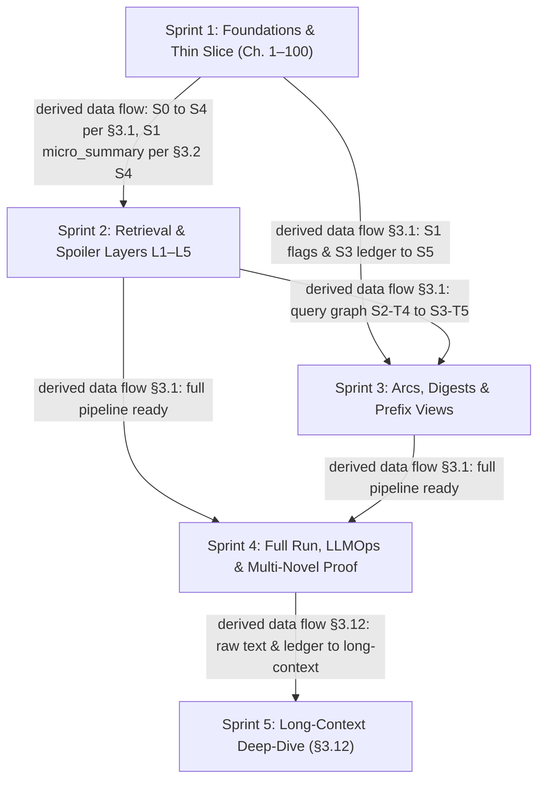

# XN-Agent — Implementation Plan (Blueprint v3 Baseline)

> **Document purpose:** Detailed engineering implementation plan for the **XN-Agent** system, derived from `ARCHITECTURE_BLUEPRINT_v3.md` (superseding v2) compared against the prototype codebase in `src/`.
> **Baseline reference:** `ARCHITECTURE_BLUEPRINT_v3.md` (Rev 3.2, 2026-10-30).
> **Domain terms:** Vietnamese domain terms (*cảnh giới, pháp bảo, linh thú, khôi lỗi, công pháp, bí cảnh, quyển*) are preserved as in the blueprint.
> **Constraint:** Purely technical and faithful to the blueprint. Any underspecified or conflicting requirements are cataloged as formal Open Questions (`OQ-n`, `BP-OQ-n`) without inventing unilateral decisions.

---

## 1. Current State vs. Blueprint Analysis

The prototype in `src/` represents a rapid architectural spike (commit `8894ce7`). Below is the per-file disposition mapping the prototype code to blueprint specifications (§0.2, Phase 1 audit findings G-01 through G-21), documenting concrete gaps verified against repository files.

### 1.1 Prototype File Audit & Dispositions

| Prototype File | Blueprint Disposition / Status (§0.2 or Inferred) | Concrete Gaps & Deficiencies Found in Code | Blueprint Reference |
|---|---|---|---|
| `src/cli.py` | **Replace** (Ingest loop & query handling) | • Flat `src.` imports (`from src.ingestion...`) rather than blueprint package namespace `src.xn...`. • Uses `sorted(glob.glob(os.path.join(raw_dir, "*.txt")))` sorting lexically rather than extracting integer $N$ from `^chapter_(\d+)\.md$` (G-10: `chapter_10` sorts before `chapter_2`). • Ingest loop has no stage isolation, job state tracking, input hashing, or per-chapter transactions (G-03, G-19). • Hardcodes `LifecycleEventType.CLASH` for every entity extracted (G-04). • CLI options lack `--novel`, `--stage`, `--from`, `--to`, `--stale-only`, `--until`, `--full`, `--mode`. • Query command initializes state with `query=prompt` and `intent`/`target_entity` as `None`, passing unparsed query directly to the graph without CLI arguments for `novel_id` or spoiler bounds (`--until`, `--mode`) (G-02, §3.3). | §0.2, §3.2 S0, §3.2 S3, §3.3, §3.6 |
| `src/config.py` | **Replace / Split [not listed in §0.2 (inferred)]** | • Implements a single flat `pydantic_settings.BaseSettings` loading only `.env` and `configs/config.yaml`. • No multi-novel isolation or loading of `configs/genres/<genre>.yaml` or `configs/novels/<id>.yaml` (G-21). • Missing config fields: configured fallback model (§3.3; proposed name `FALLBACK_MODEL`), daily spend cap (§3.7; proposed name `DAILY_SPEND_CAP`), `LONG_CONTEXT_MODEL` (§3.12), prompt versions (§3.5), spend approval thresholds (§3.12). • Import-time execution of `Settings()` and YAML parsing (G-12). | §3.2, §3.11, §3.12 (not in §0.2) |
| `src/agents/graph_workflow.py` | **Replace** | • Instantiates `SQLiteLedger()` and `QdrantManager()` eagerly at import time (G-12). • Heuristic keyword-based routing in `router_node` (`"mốc"`, `"thời gian"`, etc.) instead of typed Pydantic-AI `RouterDecision` on local Qwen (G-02). • `router_node` assigns `state["target_entity"] = state["query"]`, which breaks entity resolution (G-02). • `timeline_node` performs synchronous HTTP `httpx.Client.post()` directly to OpenRouter without retrieval or citations (G-01, ADR-01). • `deep_dive_node` executes SQL `LIKE %name%` without alias normalization; falls back to LLM memory ("tri thức nền tảng") on miss (G-01); concatenates all ledger rows without context budget cap (G-07). • Lacks `bound`, `resolve_entities`, `gate`, `verify` (with spoiler scan), `plan_long`, `map_arcs`, `reduce` nodes. • Lacks LangGraph `SqliteSaver` checkpointer and thread-isolated memory. | §0.2, §3.1, §3.3, §3.4, §3.12 |
| `src/agents/pydantic_agents.py` | **Replace / Evolve [not listed in §0.2 (inferred)]** | • Uses deprecated Pydantic-AI API: `OpenAIModel(base_url=...)`, `result_type=...`, and reads `.data` (G-09). • Hardcodes static prompt strings in Python code instead of loading versioned Markdown templates from `prompts/<name>/<version>.md` with Jinja2 placeholders (G-13, §3.5). • Instantiates models at import time with fallback dummy keys (`"sk-dummy"`, `"ollama"`) rather than lazy factories (G-12). • Missing agents: router, entity adjudicator, arc boundary reviewer, prefix summarizer, long-context map/reduce agents. | §3.3, §3.5, §3.9, §3.12 (not in §0.2) |
| `src/ingestion/pydantic_extractor.py` | **Replace (Stage S1) [not listed in §0.2 (inferred)]** | • Hard-truncates text at `text[:9000]`, dropping 20–25% of chapter content (G-06). • No token counting or 2-part splitting with overlap for chapters > 7,000 tokens (§3.2 S1). • Dumps ad-hoc JSON files to `./data/extracted_json` rather than storing structured records in SQLite `extractions` table with input hashing and transaction rollbacks (G-03). • Reads `result.data` (superseded API; should be `result.output`). • Lacks code-side verification of verbatim quotes (`partial_ratio >= 85`) against source text. | §3.2 S1, §3.9 (not in §0.2) |
| `src/schemas/extraction.py` | **Evolve** | • `EntityCategory` is a hardcoded Python `Enum` (xianxia-specific: character, weapon_treasure, puppet_beast, technique, dungeon) rather than a profile-validated string against `configs/genres/<genre>.yaml` (G-21, §3.11). • `RawEntityAction` lacks `event_type: LifecycleEventType`, `holder: Optional[str]`, `same_as: Optional[str]`, `evidence: str` (≤25 words), and length limits (`description` ≤ 400, `evidence` ≤ 200) (G-04, §3.2 S1). • `ChapterExtraction` flags differ: prototype uses `is_map_change`, `is_realm_breakthrough`, `is_major_conflict`, whereas v3 specifies `location_change: bool`, `mc_realm: Optional[str]`, `realm_breakthrough: bool`, `major_conflict: bool`. • Lacks code-side validators for category membership, evidence fuzzy match, and `chapter_id` overwrite from S0. | §0.2, §3.2 S1, §3.11 |
| `src/schemas/lifecycle.py` | **Evolve** | • `LifecycleEventType` lacks `USED_IN_BATTLE`, `REVEALED_IDENTITY`, `MENTIONED` and still retains `CLASH` (G-04, §3.2). • `EntityLifecycleRecord` lacks `novel_id`, `ordinal`, `evidence`, `holder_entity_id`, and `realm_rank` (which is required by SQLite `entity_events`). | §0.2, §3.2 S3 |
| `src/schemas/arc.py` | **Evolve** | • Lacks `novel_id`, `prompt_version`, `model`, and alignment with SQLite `arcs` table (`start_chapter`, `end_chapter`, `payload JSON`, `prompt_version`, `model`). • Fields do not match S6 macro synthesizer input/output contract. | §0.2, §3.2 S6 |
| `src/schemas/state.py` | **Replace [not listed in §0.2 (inferred)]** | • Prototype `AgentState` contains only `query`, `intent`, `target_entity`, `target_aspect`, `retrieved_events`, `retrieved_arcs`, `final_output`, `errors`. • Blueprint requires `QueryState(TypedDict, total=False)` containing `novel_id`, `chapter_max`, `mode`, `lc_plan`, `query`, `thread_id`, `decision: RouterDecision`, `entity_ids`, `unresolved_mentions`, `evidence: EvidencePack`, `answer: Answer`, `leak_report: LeakReport`, `errors`. | §3.3, §3.12 (not in §0.2) |
| `src/storage/qdrant_client.py` | **Replace** | • Hardcodes single-novel collections: `pntt_chapters`, `pntt_arcs`, `pntt_entities` (G-21). Blueprint requires 2 shared collections: `xn_chunks` and `xn_arcs` with `novel_id` tenant payload index. • Only configures dense vectors (size 1024); lacks sparse vector configuration for BGE-M3 hybrid search (G-08, ADR-03). • Lacks deterministic UUID5 point ID generation (`uuid5(NAMESPACE, f"{novel_id}:{kind}:{chapter_id}:{chunk_no}")`). • Eagerly connects in `__init__` rather than using lazy factory connection (G-12). • Lacks tenant filtering (`novel_id == X`) and range filtering (`chapter_id <= chapter_max`). | §0.2, §3.2 S4, §3.4 L1, §3.11 |
| `src/storage/sqlite_ledger.py` | **Replace** | • Only creates a single table `entity_events` with auto-increment ID, missing composite unique key `(novel_id, chapter_id, entity_id, event_type, ordinal)` (G-03). • Missing the other 14 SQLite tables defined in blueprint §3.2 (out of 15 total tables: `novels`, `chapters`, `extractions`, `entities`, `entity_aliases`, `entity_links`, `entity_events`, `arcs`, `entity_arc_digests`, `arc_prefix_summaries`, `jobs`, `llm_runs`, `answer_cache`, `lc_map_cache`, `feedback`). • Does not enable `PRAGMA journal_mode=WAL` or `PRAGMA foreign_keys=ON`. • Query method uses substring `LIKE %name%` with no spoiler filter (`chapter_id <= chapter_max`), violating L1 spoiler control. | §0.2, §3.2, §3.4 L1 |
| `src/timeline/arc_detector.py` | **Replace** | • Greedy linear segmentation: splits whenever `score >= 0.60` and `length >= 30`. • Completely ignores `max_arc_length = 90` configured in YAML (G-11). • Missing centered 5-chapter smoothing window (§3.2 S5). • Missing dynamic programming optimization maximizing cumulative score within length bounds. • Missing local LLM boundary review step using micro-summaries ±5 chapters. | §0.2, §3.2 S5 |

### 1.2 Configuration, Environment & Infrastructure Audit

1. **`docker-compose.yml`**:
   - Contains a `redis:7-alpine` service, which must be deleted per §0.2 and ADR-05 (Redis dropped; SQLite handles jobs/cache).
   - Pins Qdrant to `qdrant/qdrant:v1.12.0`. Must be verified whether v1.12.0 supports the query API, sparse vectors, and payload tenant indexes required by §3.2.
2. **`requirements.txt`**:
   - Lists loose bounds (`pydantic-ai>=0.0.18`, `langgraph>=0.2.0`, `qdrant-client>=1.9.0`).
   - Missing required libraries: `markdown-it-py` (for S0 parsing), `rapidfuzz` (for S2 entity matching), `jinja2` (for prompt templating), `ragas` (for evaluation), `opentelemetry` / tracing packages.
   - Blueprint §3.9 specifies migration to `uv` + `pyproject.toml` + `uv.lock`.
3. **`.gitignore`**:
   - Verified present on disk. Correctly excludes `.env`, `data/`, `*.db`, `qdrant_storage/`, Python cache files, and IDE directories. The blueprint item in Phase 1 table "Day 1 .gitignore" is already accomplished.
4. **`.env.example`**:
   - Referenced by `README.md`; the blueprint does not name it.
5. **Missing Directories & Baseline Files**:
   - `data/` directory is absent; `data/novels/pntt1/raw/chapter_N.md` does not exist, so assumption A-03 cannot yet be empirically validated.
   - `prompts/` directory does not exist (all prompts are embedded in Python strings).
   - `configs/genres/` and `configs/novels/` directories do not exist.
   - `tests/` directory does not exist (no unit, repository, or agent tests).
   - `eval/` directory does not exist (no gold sets or baseline metrics).
   - `pyproject.toml` and `uv.lock` do not exist.
   - Flat directory structure `src/` exists instead of package layout `src/xn/`.

---

## 2. Build Order & Sprint Breakdown (Phase 4: Sprints 1 → 5)

The project follows a 5-sprint progression (2 weeks per sprint) based on Phase 4 of `ARCHITECTURE_BLUEPRINT_v3.md`.

> **Note on file naming:** The directory layout (`src/xn/{schemas,pipeline,storage,graph,api,cli}/`, `prompts/<name>/<version>.md`, `eval/pntt1/{gold,baseline.json}`, `configs/{config.yaml,genres/xianxia.yaml,novels/pntt1.yaml}`, `data/novels/pntt1/raw/chapter_N.md`, `ollama/Modelfile.qwen14b-12k`) is taken directly from blueprint §3.9. Specific module, prompt, and test filenames within those directories (e.g., `s0_parse.py`, `database.py`, `repository.py`, `nodes/route.py`, `prompts/s1_extract/v1.md`, `test_*.py`) are proposals by this implementation plan, not blueprint decisions.
>
> **Note on inter-sprint dependencies:** Dependencies connecting stages across sprints are derived from the underlying data-flow architecture in blueprint §3.1 and §3.2; the blueprint text does not specify sprint-level completion gates.

---

### Sprint 1 — Foundations + Correct Thin Slice on `pntt1` ch. 1–100

*Goal:* Establish database, configuration, S0–S3 ingestion stages, and a working grounded query graph on the first 100 chapters without hallucinations or data corruption.

#### Task Ordering & File Matrix
- **S1-T1: Project Setup & Config Split** (§3.9, §3.11, §0.2, ADR-05)
  - *Files created:* `configs/genres/xianxia.yaml`, `configs/novels/pntt1.yaml`, `pyproject.toml` (subject to OQ-01, OQ-02), `src/xn/__init__.py` (proposal).
  - *Files changed / subject to OQ-02:* `configs/config.yaml`, `docker-compose.yml` (remove Redis service per §0.2/ADR-05), `src/config.py`, `requirements.txt` (subject to OQ-02); proposed change: `.env.example` (proposal, not in blueprint; tied to OQ-10).
  - *Dependencies:* None.
- **S1-T2: SQLite Database Schema & Repository Layer** (§3.2, §3.4 L1, §3.7)
  - *Files created:* `src/xn/storage/database.py` (proposal), `src/xn/storage/repository.py` (proposal), `tests/unit/test_repository_guards.py` (proposal).
  - *Files changed/deleted:* Supersedes `src/storage/sqlite_ledger.py` (§0.2 via `storage/*` wildcard).
  - *Details:* 15 tables with `novel_id` scoping (`novels`, `chapters`, `extractions`, `entities`, `entity_aliases`, `entity_links`, `entity_events`, `arcs`, `entity_arc_digests`, `arc_prefix_summaries`, `jobs`, `llm_runs`, `answer_cache`, `lc_map_cache`, `feedback`); WAL mode; foreign keys; repository methods strictly require `novel_id` and `chapter_max`. Unit test asserts no method accepts a missing bound.
  - *Dependencies:* S1-T1 (derived).
- **S1-T3: Pipeline Stage S0 — Parse & Clean** (§3.2 S0, G-10, G-15)
  - *Files created:* `src/xn/pipeline/s0_parse.py` (proposal), `tests/unit/test_s0_parse.py` (proposal).
  - *Files read:* `data/novels/pntt1/raw/chapter_N.md`.
  - *Details:* Match `^chapter_(\d+)\.md$`; integer sort; contiguity check; Markdown → plain text via `markdown-it-py`; NFC normalization; watermark line removal (> 5% repetition); persists `clean_text`, `sha256`, `token_count` to SQLite `chapters` table and records stage completion in `jobs` (§3.2 S0).
  - *Dependencies:* S1-T1, S1-T2 (derived from data flow: stores clean text and tokens in `chapters` table and records job status in `jobs` created in S1-T2). Also needs a `novels` row for `pntt1`, which no Sprint 1 task inserts yet (see OQ-15).
- **S1-T4: Pipeline Stage S1 — Extract (Ollama Qwen 14B)** (§3.2 S1, §3.5, §3.9, G-06)
  - *Files created:* `src/xn/pipeline/s1_extract.py` (proposal), `src/xn/schemas/extraction.py`, `prompts/s1_extract/v1.md` (proposal), `ollama/Modelfile.qwen14b-12k`.
  - *Files changed/deleted:* Supersedes `src/ingestion/pydantic_extractor.py` and `src/schemas/extraction.py`.
  - *Details:* Pydantic-AI agent on local Qwen; `num_ctx 12288`; 2-part split with 300-token overlap for chapters > 7,000 tokens; code-side fuzzy validation of `evidence` quote (partial_ratio ≥ 85) against `clean_text`. Persists extraction output (`entities` JSON, flags JSON, `micro_summary`, prompt version, model) to SQLite `extractions` table and records stage completion in `jobs` (§3.2 S1).
  - *Dependencies:* S1-T2, S1-T3 (derived from data flow: S0 text output from `chapters`, `extractions` schema and table from S1-T2).
- **S1-T5: Pipeline Stage S2 — Entity Resolution** (§3.2 S2, §3.4 L4, G-05)
  - *Files created:* `src/xn/pipeline/s2_resolve.py` (proposal), `prompts/s2_adjudicate/v1.md` (proposal).
  - *Details:* Exact normalized → diacritics-stripped → RapidFuzz token_set ≥ 92 → local LLM adjudication (80–92) → new entity. Populate `entities`, `entity_aliases`, and `entity_links` (never merged; spoiler safe).
  - *Dependencies:* S1-T2, S1-T4 (derived from data flow: resolves entities from S1 extracted events).
- **S1-T6: Pipeline Stage S3 — Idempotent Ledger Write** (§3.2 S3, G-03, G-04)
  - *Files created:* `src/xn/pipeline/s3_ledger.py` (proposal), `src/xn/schemas/lifecycle.py` (proposal), `src/xn/pipeline/runner.py` (proposal), `src/xn/cli/main.py` (proposal: implements initial CLI entry point and `xn run`), `src/xn/__main__.py` (proposal, subject to OQ-01: package execution entry point for `python -m xn`).
  - *Files changed/deleted:* Supersedes `src/schemas/lifecycle.py`.
  - *Details:* Writes `entity_events` with unique key `(novel_id, chapter_id, entity_id, event_type, ordinal)`. Per-chapter transactions. Records job status in `jobs`. Implements `xn run --novel pntt1 --stage s1 --from 1 --to 2673 [--stale-only]` CLI runner logic (blueprint §3.2 general form; Sprint 1 execution scope runs `--to 100`).
  - *Dependencies:* S1-T2, S1-T5 (derived from data flow: writes resolved entity events to ledger).
- **S1-T7: Extractor Benchmark (qwen2.5:14b vs qwen3:14b)** (Phase 2 table, Phase 4 Sprint 1, BP-OQ-1)
  - *Files changed:* `ARCHITECTURE_BLUEPRINT_v3.md` (record measured s/chapter in §3.9 cost table per Sprint 1 Acceptance Criterion 4).
  - *Task:* Benchmark on 50 chapters for schema success rate, entity recall, s/chapter, and VRAM footprint. Choose production local model. Record measured s/chapter in `ARCHITECTURE_BLUEPRINT_v3.md` §3.9 cost table (owns Sprint 1 Acceptance Criterion 4).
  - *Dependencies:* S1-T4 (derived: requires working S1 extractor and Modelfile).
- **S1-T8: Grounded Query Graph (Ledger Slice)** (§3.3, §3.4, ADR-01, ADR-02)
  - *Files created:* `src/xn/graph/workflow.py` (proposal), `src/xn/graph/nodes/route.py` (proposal), `src/xn/graph/nodes/bound.py` (proposal), `src/xn/graph/nodes/resolve.py` (proposal), `src/xn/graph/nodes/retrieve.py` (proposal), `src/xn/graph/nodes/gate.py` (proposal), `src/xn/graph/nodes/synthesize.py` (proposal), `src/xn/graph/nodes/verify.py` (proposal), `src/xn/schemas/state.py` (proposal), `prompts/router/v1.md` (proposal), `prompts/synthesize_compact/v1.md` (proposal).
  - *Files changed:* `src/xn/cli/main.py` (proposal: extend with `xn ask` query command in compact mode, §3.12).
  - *Files changed/deleted:* Supersedes `src/agents/graph_workflow.py`, `src/agents/pydantic_agents.py`, `src/cli.py`, `src/schemas/state.py`.
  - *Details:* LangGraph flow: `route` → `bound` → `resolve_entities` → `retrieve` (ledger-only) → `gate` → `synthesize` → `verify`. Verifies citations exist in evidence and are ≤ N. Implements initial `xn ask` query command as a proposal (blueprint §3.12 names `xn ask`; initially wired in compact mode).
  - *Dependencies:* S1-T2, S1-T6 (derived from data flow: queries populated ledger).
- **S1-T9: Gold Set Annotation & Eval Harness** (§3.8, OQ-09, OQ-14)
  - *Files created:* `eval/pntt1/` gold assets (20 chapters, 80 alias pairs, 15 Q&A, 10 spoiler probes per blueprint Phase 4), `tests/eval/test_gold.py` (proposal).
  - *Dependencies:* S1-T8 (derived: evaluates grounded query graph).

#### Sprint 1 Acceptance Criteria (copied from blueprint Phase 4)
1. Two consecutive ingest runs give identical row counts.
2. Deep-dive on 3 entities cites only chapters $\le N$.
3. Extraction recall $\ge 0.80$.
4. Measured s/chapter recorded in the blueprint's §3.9 cost table ("Time & cost model for pntt1") (owned by S1-T7).

#### Parallelism & Ordering Constraints
- *Parallel groups:* Once S1-T4 is complete, S1-T7 (Benchmark) can run in parallel with S1-T5 (S2 Resolve), as they touch disjoint files (`ARCHITECTURE_BLUEPRINT_v3.md` vs `src/xn/pipeline/s2_resolve.py` / `prompts/s2_adjudicate/v1.md`) and neither depends on the other.
- *Internal constraints:* S1-T3 depends on S1-T2 to write clean text to `chapters` and stage progress to `jobs`. S1-T4 requires S1-T3 clean text. S1-T5 (S2 Resolve) requires S1-T4 extracted events. S1-T6 writes resolved events to ledger and implements `xn run`. S1-T8 query graph in Sprint 1 retrieves strictly from the ledger (no S4 Qdrant chunks or reranker exist yet) and extends `main.py` with `xn ask`.

---

### Sprint 2 — Retrieval + Spoiler Layers L1–L5

*Goal:* Implement BGE-M3 hybrid vector search in Qdrant, multi-tenant payload indexing, reranking, and full L1–L5 spoiler prevention layers.

#### Task Ordering & File Matrix
- **S2-T1: Qdrant Multi-tenant Setup & Manager** (§3.2, §3.9, §3.11, ADR-03, ADR-06)
  - *Files created:* `src/xn/storage/qdrant.py` (proposal), `tests/integration/test_tenant_isolation.py` (proposal).
  - *Files changed:* `docker-compose.yml` (upgrade Qdrant image per §0.2/§3.9 with target version subject to OQ-08; placement in Sprint 2 is derived as S2-T1 is the first consumer, as §0.2 names no sprint).
  - *Files changed/deleted:* Supersedes `src/storage/qdrant_client.py` (§0.2 via `storage/*` wildcard).
  - *Details:* Manage shared collections `xn_chunks` and `xn_arcs`. Setup dense (1024 cosine) and sparse vectors. Payload indexes on `xn_chunks`: `novel_id`, `chapter_id`, `arc_id`, `kind`, `entity_ids` (§3.2 S4). Payload indexes on `xn_arcs`: `novel_id`, `arc_id`, `start_chapter`, `end_chapter` (§3.2 S6; infrastructure configured here, with `xn_arcs` population executed in S3-T2). Deterministic UUID5 point IDs.
  - *Dependencies:* S1-T2 (derived from data flow: storage/repository configuration).
- **S2-T2: Pipeline Stage S4 — Chunk & Embed** (§3.2 S4, §3.9)
  - *Files created:* `src/xn/pipeline/s4_embed.py` (proposal).
  - *Details:* Runs in a separate GPU window (Ollama stopped). Paragraph chunks ~450 tokens (60 overlap) + micro-summaries from S1 (§3.2 S4). BGE-M3 dense + sparse vectors written to `xn_chunks`.
  - *Dependencies:* S1-T3, S1-T4, S2-T1 (derived from data flow: S1-T3 provides clean text from `chapters`, S1-T4 persists `micro_summary` in `extractions` per §3.2 S4, and S2-T1 provides Qdrant `xn_chunks` collection setup).
- **S2-T3: Hybrid Retrieval & Reranker** (§3.2 S4, §3.3, §3.9)
  - *Files created:* `src/xn/storage/retriever.py` (proposal).
  - *Files changed:* `src/xn/graph/nodes/retrieve.py` (proposal: wire hybrid retriever).
  - *Details:* Qdrant query API: dense k=40 + sparse k=40 prefetch → RRF fusion → hard filter `novel_id == X AND chapter_id <= chapter_max` → rerank top-30 with `bge-reranker-v2-m3` fp16 on GPU (~1.2 GB) to top-8 (BGE-M3 query encoding on CPU, §3.9).
  - *Dependencies:* S1-T8, S2-T2 (derived from data flow: changes the `retrieve` node created in S1-T8 and queries chunks embedded in S2-T2).
- **S2-T4: Expand Query Graph (Factual QA, Compare)** (§3.3)
  - *Files changed:* `src/xn/graph/nodes/route.py` (proposal), `src/xn/graph/nodes/retrieve.py` (proposal), `src/xn/graph/nodes/gate.py` (proposal), `src/xn/graph/nodes/synthesize.py` (proposal), `src/xn/graph/workflow.py` (proposal).
  - *Details:* Wire `factual_qa` and `compare` intents into LangGraph. Reranker score threshold $\ge 0.3$ in `gate`.
  - *Dependencies:* S1-T8, S2-T3 (derived from data flow: integrates hybrid retriever into query graph).
- **S2-T5: Reading Progress & Bound Resolution CLI** (§3.4 L1, §3.6)
  - *Files changed:* `src/xn/cli/main.py` (proposal), `src/xn/storage/repository.py` (proposal), `src/xn/graph/nodes/bound.py` (proposal: update bound resolution to integrate `novels.reader_progress` via `xn progress`).
  - *Details:* Implement `xn progress <novel_id> <N>` command (§3.4); update `novels.reader_progress`. Implement deterministic resolution (§3.3 `bound`, §3.4): `chapter_max = min(explicit --until or chapter_hint or novels.reader_progress or total_chapters, total_chapters)`; `--full` removes the bound explicitly; the resolved N is printed with every answer.
  - *Dependencies:* S1-T2, S1-T8 (derived: adds CLI command and bound methods to existing CLI/repository/bound node).
- **S2-T6: L5 Spoiler Leak Detection & Mitigation** (§3.4 L5, R-01, R-02)
  - *Files created:* `src/xn/graph/nodes/spoiler_scan.py` (proposal), `tests/unit/test_spoiler_scan.py` (proposal).
  - *Files changed:* `src/xn/graph/nodes/verify.py` (proposal).
  - *Details:* Deterministic scan matching answer text against aliases with `first_chapter > N` and realm names above max `realm_rank` seen $\le N$. Regenerate once with forbidden terms; redact sentence on second failure (`[đã ẩn để tránh tiết lộ]`).
  - *Dependencies:* S1-T2, S1-T5, S1-T8, S2-T5 (derived from data flow: uses aliases from S2 and resolved bound from S2-T5 in verify node).

#### Sprint 2 Acceptance Criteria (copied from blueprint Phase 4)
1. Context recall $\ge 0.75$ on 15 Q&A.
2. **0 leaks** on 10 spoiler probes.
3. Factual QA p95 latency $\le 15$ s.

#### Parallelism & Ordering Constraints
- *Parallel groups:* S2-T1/S2-T2 (vector storage and chunk embedding) and S2-T5 (reading progress CLI command and repository/bound update) touch disjoint files and have no dependency path between them, so they can run in parallel.
- *Internal constraints:* S4 embedding (S2-T2) must unload Ollama to avoid 16 GB VRAM thrashing on RTX 5070 Ti (§3.9). Query reranker (S2-T3) must precede `factual_qa` gate wiring (S2-T4). S2-T6 integrates into the verify node after bound resolution in S2-T5 is ready.

---

### Sprint 3 — Arcs, Digests, Prefix Views

*Goal:* Build macro-level story structures (S5–S7) and spoiler-safe prefix summaries, enabling bounded deep-dives and timeline queries.

#### Task Ordering & File Matrix
- **S3-T1: Pipeline Stage S5 — Smoothed DP Arc Segmentation** (§3.2 S5, G-11, OQ-04)
  - *Files created:* `src/xn/pipeline/s5_segment.py` (proposal), `prompts/s5_boundary_review/v1.md` (proposal).
  - *Files changed/deleted:* Supersedes `src/timeline/arc_detector.py`.
  - *Details:* Chapter score $s_i = \sum w \cdot \text{flag}$; centered smoothing window 5; DP segmentation picking boundaries subject to $30 \le \text{len} \le 90$; local LLM reviews boundary with micro-summaries $\pm 5$ chapters (shift $\le 5$). Output storage for S5 boundaries is an inference (inferred: records boundaries to `chapters.arc_id`; S6 writes full `StoryArc` JSON to `arcs`, §3.1, §3.2 S6). Whether S5 writes placeholder rows to `arcs` or stores boundaries via stage jobs / in-memory is an open question (OQ-05).
  - *Dependencies:* S1-T4, S1-T6 (derived from data flow, §3.1 diagram: requires S1 extraction flags across all chapters in range).
- **S3-T2: Pipeline Stage S6 — Macro StoryArc Synthesis** (§3.2 S6)
  - *Files created:* `src/xn/pipeline/s6_synthesize.py` (proposal), `src/xn/schemas/arc.py` (proposal), `prompts/s6_arc_synthesize/v1.md` (proposal).
  - *Files changed / used:* `src/xn/storage/qdrant.py` (proposal: writes arc vector to `xn_arcs` collection).
  - *Files changed/deleted:* Supersedes `src/schemas/arc.py`.
  - *Details:* Calls OpenRouter macro model with concatenated micro-summaries (~12k tokens in); writes `StoryArc` JSON to SQLite `arcs` and embeds arc summary into Qdrant `xn_arcs`.
  - *Dependencies:* S3-T1, S2-T1 (derived from data flow: S3-T1 provides segmented arcs; S2-T1 initializes Qdrant manager and `xn_arcs` collection to which S6 writes arc vectors, §3.1, §3.2 S6).
- **S3-T3: Pipeline Stage S7 — Entity×Arc Digests & Prefix Digests** (§3.2 S7, §3.4 L3, G-07)
  - *Files created:* `src/xn/pipeline/s7_digest.py` (proposal), `prompts/s7_digest/v1.md` (proposal).
  - *Details:* For each (entity, arc) with $\ge 3$ events: local LLM produces 80–150 word digest, stored in `entity_arc_digests` (§3.2 S7). Also precomputes prefix entity digests (`upto_chapter`) at spoiler checkpoints (§3.2 S7, §3.4 L3, Phase 4 Sprint 3).
  - *Dependencies:* S1-T6, S3-T1 (derived from data flow: events from ledger grouped by arc boundaries).
- **S3-T4: Arc Prefix Summaries (L2 Spoiler Safety)** (§3.2 S7, §3.4 L2)
  - *Files created:* `src/xn/pipeline/prefix_summaries.py` (proposal).
  - *Details:* Precompute prefix summaries every 10 chapters using local model; store in `arc_prefix_summaries` (§3.4 L2, §3.9). Query-time snap down to nearest 10-chapter checkpoint + append raw micro-summaries.
  - *Dependencies:* S1-T4, S3-T1 (derived from data flow: micro-summaries grouped by arc boundaries).
- **S3-T5: Query Graph Integration (Timeline & Deep-Dive Budgeting)** (§3.3, §3.4)
  - *Files changed:* `src/xn/graph/nodes/retrieve.py` (proposal), `src/xn/graph/nodes/synthesize.py` (proposal).
  - *Details:* Timeline intent uses arcs fully $\le N$ + prefix summary of current arc from S3-T4 (§3.4 L2). Deep-dive uses entity×arc digests (full digest if arc ends $\le N$, prefix digest `upto_chapter` from S3-T3 if arc straddles $N$, §3.4 L3) + top-25 ranked events + top-8 chunks. Strict 20k-token evidence budget enforcement.
  - *Dependencies:* S2-T4, S3-T2, S3-T3, S3-T4 (derived from data flow: integrates arc summaries and digests into retrieval under 20k token cap).

#### Sprint 3 Acceptance Criteria (copied from blueprint Phase 4)
1. Boundary F1 $\ge 0.80$ on chapters 1–600 ($\pm 3$ chapters).
2. Protagonist deep-dive $\le 20\text{k}$ evidence tokens at any $N$.
3. **0 leaks** on arc-straddling probes.

#### Parallelism & Ordering Constraints
- *Parallel groups:* Once S3-T1 (Arc boundaries) finishes, S3-T2 (Arc synthesis), S3-T3 (Entity digests), and S3-T4 (Prefix summaries) touch disjoint files (`s6_synthesize.py`, `s7_digest.py`, `prefix_summaries.py`, and separate prompt templates) and have no dependency path between them, so they can run in parallel.
- *Internal constraints:* S5 requires S1 flags across all chapters in range. S3-T5 integrates arc synthesis and digests into query graph once S3-T2, S3-T3, and S3-T4 complete.

---

### Sprint 4 — Full Run, LLMOps, Multi-Novel Proof

*Goal:* Complete ingestion of all 2,673 chapters of *Phàm Nhân Tu Tiên 1*, pass all evaluation thresholds, implement FastAPI/SSE endpoints, and prove multi-novel extensibility with zero code modifications.

#### Task Ordering & File Matrix
- **S4-T1: Full Ingestion Run on `pntt1` (Ch. 1–2,673)** (§3.2, §3.9, §3.10)
  - *Task:* Execute S0 → S7 over entire novel using 2-slot Ollama concurrency. Monitor and clear failure queue (`jobs.status = 'failed'`). Verify wall-clock time $\le 20$ h and total cloud spend $\le \$5$ (owns Sprint 4 Acceptance Criterion 4).
  - *Dependencies:* S2-T2, S3-T2, S3-T3, S3-T4 (derived from data flow: full ingestion stages S0–S7 operational).
- **S4-T2: Full Evaluation Suite & Benchmark** (§3.8, OQ-09, OQ-14)
  - *Files created / changed:* `eval/pntt1/` gold assets (updated to 40 annotated chapters, 150 alias pairs, 40 Q&A, 30 spoiler probes per blueprint §3.8), `eval/pntt1/baseline.json`, `tests/eval/test_gold.py` (proposal: updated test cases).
  - *Task:* Run full evaluation against §3.8 thresholds (entity recall $\ge 0.85$, precision $\ge 0.90$, event accuracy $\ge 0.75$, flag F1 $\ge 0.80$, alias F1 $\ge 0.90$, boundary F1 $\ge 0.80$, RAGAS faithfulness $\ge 0.85$, context recall $\ge 0.80$, citation hit rate $\ge 0.80$, 0 leaks on 30 spoiler probes).
  - *Dependencies:* S1-T9, S4-T1, S2-T6, S3-T5 (derived from data flow: extends the gold assets and eval harness created in S1-T9, evaluates full novel ingestion output, Q&A via query graph S3-T5, and spoiler probes via L5 leak scan S2-T6).
- **S4-T3: LLMOps Tracing & SQL Telemetry Views** (§3.5, §3.8, G-13)
  - *Files created:* `src/xn/telemetry/tracing.py` (proposal), `src/xn/storage/views.sql` (proposal).
  - *Details:* Pydantic-AI OpenTelemetry instrumentation to Langfuse/Logfire. SQL views for retry rate per prompt, failed chapters, stage cost/tokens, grounding ratio, spoiler hits.
  - *Dependencies:* S4-T1 (derived: telemetry and views over full run data).
- **S4-T4: CI Automation & Quality Gates** (§3.5, §3.8, §3.9, OQ-03, OQ-10)
  - *Files used / changed:* `tests/eval/test_gold.py` (proposal; regression gate command is `pytest tests/eval -m gold --novel pntt1` per §3.5, failing if any metric drops > 2 points vs `eval/{novel_id}/baseline.json`; blueprint §3.8 explicitly notes eval runs on demand, not in CI). Proposed change: `README.md` (proposal, not in blueprint; tied to OQ-10).
  - *Dependencies:* S4-T2 (derived: requires `baseline.json` established in S4-T2).
- **S4-T5: FastAPI Service & SSE Streaming Endpoint** (§3.6, Phase 4 Sprint 4)
  - *Files created:* `src/xn/api/app.py` (proposal), `src/xn/api/routes.py` (proposal), `src/xn/api/schemas.py` (proposal).
  - *Details:* Expose eight endpoints defined in blueprint §3.6 table: (1) `GET /v1/novels`; (2) `PUT /v1/novels/{novel_id}/progress`; (3) `POST /v1/novels/{novel_id}/query` (SSE streaming); (4) `GET /v1/novels/{novel_id}/entities?q=&until=`; (5) `GET /v1/novels/{novel_id}/entities/{id}/timeline?until=`; (6) `GET /v1/novels/{novel_id}/arcs?until=`; (7) `POST /v1/novels/{novel_id}/pipeline/runs`; (8) `GET /v1/pipeline/runs/{run_id}`. (The ninth route, `POST /v1/novels/{novel_id}/query/{thread_id}/resume`, is owned by S5-T3 per Phase 4 Sprint 5 "LangGraph interrupt approval (CLI prompt + API resume)"). Single-flight stage runs.
  - *Dependencies:* S4-T1, S2-T5, S3-T5 (derived from data flow: wraps completed query graph S3-T5, reading progress resolution S2-T5, and pipeline execution S4-T1).
- **S4-T6: Multi-Novel Onboarding Validation (Second Novel Proof)** (§3.11, G-21)
  - *Files created:* `configs/novels/<id>.yaml` (for a second novel, e.g. a sample novel config), `data/novels/<id>/raw/` (sample 200 ch).
  - *Files used / changed:* `tests/integration/test_tenant_isolation.py` (proposal).
  - *Task:* Onboard a 200-chapter sample novel using configuration only. Verify zero code changes. Run cross-novel bleed test asserting queries on novel A never return novel B records.
  - *Dependencies:* S4-T5 (derived: validates novel-scoped API and isolation).
- **S4-T7: (Optional) Local Web UI with Reading Progress Slider** (§3.6)
  - *Files created:* `src/xn/ui/` (proposal: static HTML/JS/CSS).
  - *Details:* Reading-progress slider on every view; citation click opens evidence quote panel; feedback thumbs written to `feedback` table.
  - *Dependencies:* S4-T5 (derived: connects to FastAPI SSE endpoints).

#### Sprint 4 Acceptance Criteria (copied from blueprint Phase 4)
1. All §3.8 thresholds met or recorded as accepted risk.
2. Second novel needs no code change.
3. Cross-novel bleed test passes.
4. `pntt1` cloud spend $\le \$5$ (owned by S4-T1).

#### Parallelism & Ordering Constraints
- *Parallel groups:* Once S4-T1 is complete (with prior sprint prerequisites S2-T5, S2-T6, S3-T5 already in place): S4-T2 (Full Evaluation Suite), S4-T3 (LLMOps Tracing & SQL Views), and S4-T5 (FastAPI Service) touch disjoint files (`eval/`, `src/xn/telemetry/tracing.py` / `src/xn/storage/views.sql`, `src/xn/api/`) and have no dependency path between them, so they can run in parallel. S4-T4 proceeds once S4-T2 establishes baseline metrics. S4-T6 proceeds once S4-T5 exposes the API. S4-T7 is optional and non-blocking.
- *Internal constraints:* S4-T2 (Evaluation) and S4-T6 (Second novel) require completed pipeline data from S4-T1. S4-T2 also relies on query graph (S3-T5) and L5 scanner (S2-T6); S4-T5 wraps reading progress (S2-T5) and query graph (S3-T5).

---

### Sprint 5 — Long-Context Deep-Dive (§3.12)

*Goal:* Implement raw-chapter reading for deep-dive queries using a $\ge 1\text{M}$-context cloud model with cost pre-estimation, user confirmation interrupts, map-reduce arc execution, and quote verification.

#### Task Ordering & File Matrix
- **S5-T1: OpenRouter Model Catalog & Pricing Integration** (§3.12, A-08)
  - *Files created:* `src/xn/graph/long_context/pricing.py` (proposal).
  - *Details:* Fetch OpenRouter model list at startup; cache `context_length` and per-token pricing for `LONG_CONTEXT_MODEL`. Sized budget = 70% of context window.
  - *Dependencies:* S4-T5 (derived: queries OpenRouter API at application startup).
- **S5-T2: Long-Context Planner (`plan_long`)** (§3.12)
  - *Files created:* `src/xn/graph/long_context/planner.py` (proposal), `src/xn/schemas/long_context.py` (proposal).
  - *Details:* Gathers entity events $\le N$; ranks chapters into **key** (full text) vs. **supporting** (excerpts $\pm 2$ paragraphs); selects `single_pass` vs. `map_reduce` (by arc); checks `lc_map_cache`; calculates token/cost estimate.
  - *Dependencies:* S5-T1 (derived: requires model context window and pricing cache).
- **S5-T3: Cost Approval Interrupt Mechanism** (§3.6, §3.12, Phase 4 Sprint 5)
  - *Files changed:* `src/xn/graph/workflow.py` (proposal), `src/xn/cli/main.py` (proposal), `src/xn/api/routes.py` (proposal).
  - *Details:* If `est_cost_usd > approval_threshold_usd` (default $0.50), trigger LangGraph `interrupt()`. CLI prompts `[y/N]` (or `--yes`); API exposes `/v1/novels/{novel_id}/query/{thread_id}/resume` endpoint (§3.6, Phase 4 Sprint 5). Extends `xn ask` CLI command with `--mode long` and `--novel` per blueprint §3.12.
  - *Dependencies:* S5-T2 (derived: triggers interrupt based on planner's estimated cost).
- **S5-T4: Single-Pass & Map-Reduce Engine** (§3.12)
  - *Files created:* `src/xn/graph/long_context/engine.py` (proposal), `prompts/lc_map/v1.md` (proposal), `prompts/lc_reduce/v1.md` (proposal).
  - *Details:* `map_arcs` with LangGraph `Send` (3 in parallel); outputs cached in `lc_map_cache`; `reduce` synthesizes `DeepDiveReport` from `ArcEntityAnalysis` batches.
  - *Dependencies:* S5-T3 (derived: execution commences only after approval).
- **S5-T5: Long-Context Verifier & Quote Matcher** (§3.12)
  - *Files created:* `src/xn/graph/long_context/verify.py` (proposal).
  - *Files changed:* `src/xn/graph/nodes/verify.py` (proposal: integrate long-context checks).
  - *Details:* Validates that cited chapters are a subset of chapters sent; verifies verbatim quotes against `clean_text` (partial_ratio $\ge 90$); executes L5 spoiler scan on final report; logs egress payload chapters to `llm_runs`.
  - *Dependencies:* S5-T4, S2-T6 (derived from data flow: S5-T4 provides engine report output; S2-T6 provides the L5 spoiler scan reused on the rendered report, §3.4 L5, §3.12).
- **S5-T6: Long-Context Gold Evaluation (10 Probes)** (§3.8, §3.12, OQ-14)
  - *Files created / changed:* `eval/pntt1/` gold assets (updated with 10 long-context deep-dive probes per blueprint §3.8).
  - *Task:* Evaluate 10 deep-dives (protagonist, 4 major pháp bảo/khôi lỗi, 5 minor entities). Run pairwise judge vs. compact mode.
  - *Dependencies:* S5-T5 (derived: evaluates completed long-context report outputs).

#### Sprint 5 Acceptance Criteria (copied from blueprint Phase 4)
1. Minor item single pass $\le 3$ min and $\le \$0.10$ on DeepSeek-class model.
2. Protagonist map-reduce $\le 8$ min with a correct plan estimate ($\pm 20\%$).
3. **0 spoiler leaks** on long-context probes.
4. §3.8 long-context thresholds met: long-context preferred $\ge 60\%$; citations $\ge 95\%$ valid; quotes $\ge 95\%$ verbatim.

#### Parallelism & Ordering Constraints
- *Parallel groups:* Tasks in Sprint 5 form a direct sequential execution pipeline (Planner $\to$ Interrupt $\to$ Engine $\to$ Verifier $\to$ Evaluation). No tasks in Sprint 5 can run in parallel as each depends directly on the output of the preceding task.

---

## 3. Comprehensive File-by-File Table

> **Note on file naming:** Directory layout is from blueprint §3.9; individual filenames within packages/directories are proposals by this plan, not blueprint decisions. The "Name source" column explicitly distinguishes between exact paths specified in the blueprint ("blueprint"), existing files not named by the blueprint ("existing file, not named by blueprint"), and filenames proposed by this plan ("proposed").

Repository files and planned assets mapped to sprint tasks and blueprint specifications:

| File Path | Action | Sprint / Task | Source Blueprint Section | Name Source |
|---|---|---|---|---|
| `docs/IMPLEMENTATION_PLAN.md` | **Create** | Current Task | Brief / Complete v3 Plan | proposed |
| `ARCHITECTURE_BLUEPRINT_v3.md` | **Change** | S1-T7 | §3.9 (Sprint 1 Criterion 4) | blueprint |
| `docker-compose.yml` | **Change** | S1-T1, S2-T1 | §0.2, §3.9, ADR-05 | blueprint |
| `requirements.txt` | **Change** | S1-T1 | §3.9 (or OQ-02) | existing file, not named by blueprint |
| `pyproject.toml` | **Create (subject to OQ-01, OQ-02)** | S1-T1 | §3.9 | blueprint |
| `.env.example` | **Change (proposal, not in blueprint; tied to OQ-10)** | S1-T1 | §3.9 (OQ-10) | existing file, not named by blueprint |
| `configs/config.yaml` | **Change** | S1-T1 | §3.5, §3.9, §3.11 | blueprint |
| `configs/genres/xianxia.yaml` | **Create** | S1-T1 | §3.11 | blueprint |
| `configs/novels/<id>.yaml` (e.g. `pntt1.yaml`) | **Create** | S1-T1, S4-T6 | §3.11 | blueprint |
| `data/novels/<id>/raw/` (e.g. `chapter_N.md`) | **Read / Create** | S1-T3, S4-T6 | §3.1, §3.2 S0, §3.11 | blueprint |
| `ollama/Modelfile.qwen14b-12k` | **Create** | S1-T4 | §3.9 | blueprint |
| `src/config.py` | **Change / Move** | S1-T1 | §3.2, §3.11 | existing file, not named by blueprint |
| `src/xn/__init__.py` | **Create** | S1-T1 | §3.9 | proposed |
| `src/xn/storage/database.py` | **Create** | S1-T2 | §3.2 | proposed |
| `src/xn/storage/repository.py` | **Create** | S1-T2, S2-T5 | §3.2, §3.4 L1 | proposed |
| `src/storage/sqlite_ledger.py` | **Delete** | S1-T2 | §0.2, §3.2 | §0.2 via `storage/*` wildcard |
| `src/xn/pipeline/s0_parse.py` | **Create** | S1-T3 | §3.2 S0 | proposed |
| `src/xn/schemas/extraction.py` | **Create** | S1-T4 | §3.2 S1 | blueprint |
| `src/schemas/extraction.py` | **Delete** | S1-T4 | §0.2, §3.2 S1 | blueprint |
| `prompts/s1_extract/v1.md` | **Create** | S1-T4 | §3.2 S1, §3.5 | proposed |
| `src/xn/pipeline/s1_extract.py` | **Create** | S1-T4 | §3.2 S1 | proposed |
| `src/ingestion/pydantic_extractor.py` | **Delete** | S1-T4 | §0.2, §3.2 S1 | existing file, not named by blueprint |
| `src/xn/pipeline/s2_resolve.py` | **Create** | S1-T5 | §3.2 S2 | proposed |
| `prompts/s2_adjudicate/v1.md` | **Create** | S1-T5 | §3.2 S2, §3.5 | proposed |
| `src/xn/schemas/lifecycle.py` | **Create** | S1-T6 | §3.2 S3 | proposed |
| `src/schemas/lifecycle.py` | **Delete** | S1-T6 | §0.2, §3.2 S3 | blueprint |
| `src/xn/pipeline/s3_ledger.py` | **Create** | S1-T6 | §3.2 S3 | proposed |
| `src/xn/pipeline/runner.py` | **Create** | S1-T6 | §3.2 | proposed |
| `src/xn/schemas/state.py` | **Create** | S1-T8 | §3.3 | proposed |
| `src/schemas/state.py` | **Delete** | S1-T8 | §0.2, §3.3 | existing file, not named by blueprint |
| `prompts/router/v1.md` | **Create** | S1-T8 | §3.3, §3.5 | proposed |
| `prompts/synthesize_compact/v1.md` | **Create** | S1-T8 | §3.3, §3.5 | proposed |
| `src/xn/graph/nodes/route.py` | **Create / Change** | S1-T8, S2-T4 | §3.3 | proposed |
| `src/xn/graph/nodes/bound.py` | **Create / Change** | S1-T8, S2-T5 | §3.3, §3.4 L1 | proposed |
| `src/xn/graph/nodes/resolve.py` | **Create** | S1-T8 | §3.3 | proposed |
| `src/xn/graph/nodes/retrieve.py` | **Create / Change** | S1-T8, S2-T3, S2-T4, S3-T5 | §3.3 | proposed |
| `src/xn/graph/nodes/gate.py` | **Create / Change** | S1-T8, S2-T4 | §3.3 | proposed |
| `src/xn/graph/nodes/synthesize.py` | **Create / Change** | S1-T8, S2-T4, S3-T5 | §3.3 | proposed |
| `src/xn/graph/nodes/verify.py` | **Create / Change** | S1-T8, S2-T6, S5-T5 | §3.3, §3.4 L5 | proposed |
| `src/xn/graph/workflow.py` | **Create / Change** | S1-T8, S2-T4, S5-T3 | §3.3 | proposed |
| `src/agents/graph_workflow.py` | **Delete** | S1-T8 | §0.2, §3.3 | blueprint |
| `src/agents/pydantic_agents.py` | **Delete** | S1-T8 | §0.2, §3.3 | existing file, not named by blueprint |
| `src/xn/cli/main.py` | **Create / Change** | S1-T6, S1-T8, S2-T5, S5-T3 | §3.2, §3.6, §3.12 | proposed |
| `src/xn/__main__.py` | **Create** | S1-T6 | §3.2, §3.9 (OQ-01) | proposed |
| `src/cli.py` | **Delete** | S1-T8 | §0.2, §3.6 | blueprint |
| `eval/pntt1/` gold assets | **Create / Change** | S1-T9, S4-T2, S5-T6 | §3.8, §3.9, OQ-14 | blueprint |
| `eval/pntt1/baseline.json` | **Create** | S4-T2 | §3.5, §3.8, §3.9 | blueprint |
| `tests/unit/test_repository_guards.py` | **Create** | S1-T2 | §3.4 L1, §3.7 | proposed |
| `tests/unit/test_s0_parse.py` | **Create** | S1-T3 | §3.2 S0 | proposed |
| `tests/eval/test_gold.py` | **Create / Change** | S1-T9, S4-T2, S4-T4 | §3.5, §3.8 | proposed |
| `src/xn/storage/qdrant.py` | **Create / Change** | S2-T1, S3-T2 | §3.2 S4, §3.11 | proposed |
| `src/storage/qdrant_client.py` | **Delete** | S2-T1 | §0.2, §3.2 S4 | §0.2 via `storage/*` wildcard |
| `tests/integration/test_tenant_isolation.py` | **Create / Change** | S2-T1, S4-T6 | §3.7, §3.11 | proposed |
| `src/xn/pipeline/s4_embed.py` | **Create** | S2-T2 | §3.2 S4 | proposed |
| `src/xn/storage/retriever.py` | **Create** | S2-T3 | §3.2 S4, §3.3 | proposed |
| `src/xn/graph/nodes/spoiler_scan.py` | **Create** | S2-T6 | §3.4 L5 | proposed |
| `tests/unit/test_spoiler_scan.py` | **Create** | S2-T6 | §3.4 L5 | proposed |
| `src/xn/pipeline/s5_segment.py` | **Create** | S3-T1 | §3.2 S5 | proposed |
| `prompts/s5_boundary_review/v1.md` | **Create** | S3-T1 | §3.2 S5, §3.5 | proposed |
| `src/timeline/arc_detector.py` | **Delete** | S3-T1 | §0.2, §3.2 S5 | blueprint |
| `src/xn/schemas/arc.py` | **Create** | S3-T2 | §3.2 S6 | proposed |
| `src/schemas/arc.py` | **Delete** | S3-T2 | §0.2, §3.2 S6 | blueprint |
| `prompts/s6_arc_synthesize/v1.md` | **Create** | S3-T2 | §3.2 S6, §3.5 | proposed |
| `src/xn/pipeline/s6_synthesize.py` | **Create** | S3-T2 | §3.2 S6 | proposed |
| `src/xn/pipeline/s7_digest.py` | **Create** | S3-T3 | §3.2 S7 | proposed |
| `prompts/s7_digest/v1.md` | **Create** | S3-T3 | §3.2 S7, §3.5 | proposed |
| `src/xn/pipeline/prefix_summaries.py` | **Create** | S3-T4 | §3.2 S7, §3.4 L2, L3 | proposed |
| `src/xn/telemetry/tracing.py` | **Create** | S4-T3 | §3.8 | proposed |
| `src/xn/storage/views.sql` | **Create** | S4-T3 | §3.8 | proposed |
| `src/xn/api/app.py` | **Create** | S4-T5 | §3.6 | proposed |
| `src/xn/api/routes.py` | **Create / Change** | S4-T5, S5-T3 | §3.6, Phase 4 Sprint 5 | proposed |
| `src/xn/api/schemas.py` | **Create** | S4-T5 | §3.6 | proposed |
| `src/xn/ui/` | **Create** | S4-T7 | §3.6 | proposed |
| `README.md` | **Change (proposal, not in blueprint; tied to OQ-10)** | S4-T4 | §0.1, §3.1 (OQ-10) | existing file, not named by blueprint |
| `src/xn/graph/long_context/pricing.py` | **Create** | S5-T1 | §3.12 | proposed |
| `src/xn/schemas/long_context.py` | **Create** | S5-T2 | §3.12 | proposed |
| `src/xn/graph/long_context/planner.py` | **Create** | S5-T2 | §3.12 | proposed |
| `prompts/lc_map/v1.md` | **Create** | S5-T4 | §3.12, §3.5 | proposed |
| `prompts/lc_reduce/v1.md` | **Create** | S5-T4 | §3.12, §3.5 | proposed |
| `src/xn/graph/long_context/engine.py` | **Create** | S5-T4 | §3.12 | proposed |
| `src/xn/graph/long_context/verify.py` | **Create** | S5-T5 | §3.12 | proposed |

---

## 4. Impact Matrix: Assumptions, Risks & Blueprint Open Questions

Comprehensive mapping of all assumptions (A-01..A-08), accepted risks (R-01..R-04), and blueprint open questions:

| ID | Topic / Item | Status / Category | Impact on System Architecture & Work | Blocked / Affected Tasks | Validation Strategy ("Validate by") |
|---|---|---|---|---|---|
| **A-01** | Single user, local only | **Assumed** | If violated, auth and multi-user design needed. | S4-T5 (FastAPI), S1-T2 (DB), CLI | Confirm |
| **A-02** | RTX 5070 Ti 16 GB VRAM | **Confirmed** | Strictly constrains GPU resident models. Total ingestion VRAM estimate in blueprint §3.9 is ≈ 12.1 GB (Qwen 14B Q4_K_M alone is ~9.0 GB, plus KV cache and buffers) and BGE-M3 requires ≈ 4–5 GB, so they cannot run simultaneously. S4 embedding must run with Ollama unloaded. Query time keeps Qwen 14B and bge-reranker-v2-m3 (~1.2 GB) on GPU, with BGE-M3 query encoding on CPU (~0.3 s). | S1-T4, S2-T2, S2-T3, S3-T1 | Validated by confirmed hardware spec; monitor VRAM during S1-T7 benchmark. |
| **A-03** | Source format is `chapter_N.md` with potential site noise | **Confirmed format**; noise level unknown | Scraped text hygiene dictates S0 cleaning regexes. Injected URLs or site watermarks (>5% repetition) must be stripped to prevent schema pollution or embedding degradation. | S1-T3 (S0 Parse & Clean) | Inspect 10 random raw chapters provided by owner in Sprint 1. |
| **A-04** | Egress: summaries/short chunks to OpenRouter; raw chapters only in opt-in long-context mode | **Confirmed** | Strict enforcement of two egress classes (`compact` vs `long_context`). Compact mode sends only summaries, events, and $\le 8$ chunks of $\le 450$ tokens. Long-context sends raw chapters $\le N$ for one entity only upon explicit user confirmation. | S1-T8, S2-T4, S5-T4, S5-T5 | Code rule in OpenRouter client wrapper; assert chapter lists logged to `llm_runs.payload_chapters`. |
| **A-05** | Throughput ~2,500/50 tok/s on 5070 Ti; pricing & versions as marked `[verify]` | **Estimate** | Ingestion runtime (11–17 h) and cost models depend on prefill/decode speeds. Divergence alters batch slot sizing (`NUM_PARALLEL=2` vs `1`) or prompt context (`num_ctx 12288` vs `10240`). | S1-T4, S1-T7, S4-T1 | Measure exact throughput on 50 chapters during S1-T7 benchmark; verify docs/pricing at pin time. |
| **A-06** | Arcs of 30–90 chapters fit *Phàm Nhân Tu Tiên* | **Assumed** | DP segmentation constraints ($30 \le \text{len} \le 90$) depend on narrative pace. If arcs naturally exceed 90 chapters, artificial splits occur; if shorter, climax events are fragmented. | S3-T1 (S5 Arc Segmentation) | Compare segmented boundaries against the novel's published volume (*quyển*) and story structure. |
| **A-07** | Hidden identities revealed explicitly in text (`REVEALED_IDENTITY`) | **Assumed** | If identity reveals happen implicitly without a clear reveal scene, S1/S2 will fail to populate `entity_links`, leaving character timelines split. (Note: "Hàn Lập" and "Thanh Trúc Phong Vân Kiếm" appear in `src/schemas/extraction.py` description as examples). | S1-T4 (S1), S1-T5 (S2), S2-T6 (L5) | Evaluate on gold set containing known reveals and add manual links to `configs/novels/pntt1.yaml`. |
| **A-08** | $\ge 1\text{M}$-context model available on OpenRouter at target pricing | **Assumed** `[verify]` | If a $\ge 1\text{M}$ model is unavailable or prohibitively costly, long-context mode requires smaller batches, higher latency, or fallback to compact mode. | S5-T1, S5-T2, S5-T4 | Query OpenRouter model catalog at pin time during Sprint 5 planning. |
| **R-01** | Paraphrased spoilers without future names/realms bypass L5 scan | **Accepted Risk** | Low-probability leak where model mentions future plot points using vague language. Mitigated by prompt rule, 30 spoiler probes, and user feedback loop. | S2-T6, S4-T2 | Zero-leak gate on 30 spoiler probes; continuous prompt hardening. |
| **R-02** | Cloud model's parametric knowledge of popular novels | **Accepted Risk** | Model could answer from pre-training memory rather than retrieved evidence. Mitigated by evidence-only prompt, L5 scan, and citation checks (§3.7, R-02). | S1-T8, S2-T4, S3-T5 | Evidence-only prompt + L5 scan + citation checks; invalid citations are stripped. |
| **R-03** | No cross-novel entity linking for sequels | **Accepted Risk** | Characters appearing across sequels (blueprint §3.11, R-03: sequels sharing characters, e.g. `pntt2`) treated as separate entities. Multi-novel links deferred; `series_id` reserved in `novels` table. | S4-T6 | Revisit when onboarding *Phàm Nhân Tu Tiên 2*. |
| **R-04** | Long-context mode costs up to several dollars per protagonist report | **Accepted Risk** | Risk of unexpected API expenditure. Mitigated by opt-in per query, plan + approval above threshold ($0.50), daily cap, no-training providers, egress log (R-04, §3.12). | S5-T2, S5-T3 | Mandatory cost calculation before model invocation; `interrupt()` gate. |
| **BP-OQ-1** | Extractor model: `qwen2.5:14b` vs `qwen3:14b` (non-thinking) | **Blueprint OQ** | Influences schema success rate, entity recall, s/chapter, and VRAM. | S1-T4, S1-T7 | Sprint 1 benchmark across 50 chapters comparing schema success rate, entity recall, s/chapter, and VRAM. |
| **BP-OQ-2** | Cleaning patterns for *Phàm Nhân Tu Tiên 1* | **Blueprint OQ** | Incomplete cleaning patterns permit scraping watermarks into `clean_text` and vector embeddings. | S1-T3 (S0 Parse & Clean) | Inspect 10 sample raw chapters provided by owner in Sprint 1 to extract repeating site markers. |

---

## 5. Formal Open Questions List (`OQ-n`, `BP-OQ-n`)

The following genuine ambiguities, contradictions, and underspecified items are formally recorded. As mandated, no unilateral decisions are made.

### BP-OQ-1: Extractor Model Selection (`qwen2.5:14b` vs `qwen3:14b`)
- **Source:** Blueprint "Open questions" section (end of document).
- **Question:** Which local extractor model (`qwen2.5:14b` vs `qwen3:14b` non-thinking) should be locked in the Modelfile?
- **Why it matters:** Blueprint §3.9 notes Qwen2.5-14B has 48 layers while Qwen3-14B has 40 layers (`[verify]`). The choice affects schema success, recall, s/chapter, and VRAM (Phase 4 Sprint 1).
- **Which task it blocks:** S1-T4, S1-T7.
- **Options named in blueprint:** `qwen2.5:14b` vs `qwen3:14b` (non-thinking), settled by 50-chapter benchmark in Sprint 1 (Phase 2 table "qwen2.5:14b fixed" row, and Phase 4 Sprint 1).

### BP-OQ-2: Source Text Cleaning Patterns for *Phàm Nhân Tu Tiên 1*
- **Source:** Blueprint "Open questions" section (end of document).
- **Question:** What are the exact regex cleaning patterns for `pntt1` in `configs/novels/pntt1.yaml`?
- **Why it matters:** Stage S0 removes scraping noise and watermarks repeating in > 5% of chapters. Concrete patterns cannot be finalized without inspecting actual source Markdown files.
- **Which task it blocks:** S1-T3.
- **Options named in blueprint:** Settle after inspecting sample source files in Sprint 1 (Blueprint "Open questions" section (end of document) and §3.2 S0).

### OQ-01: Package Layout vs. Verifier Command Conflict
- **Question:** Should the repository migrate to package layout `src/xn/` (with invocations `python -m xn run...`) as mandated by blueprint §3.9, or maintain the flat `src/` layout (with imports `from src.storage...` and `python -m src.cli...`)?
- **Why it matters:** Blueprint §3.9 and Phase 4 explicitly require `src/xn/{schemas,pipeline,storage,graph,api,cli}/`. However, existing prototype files use `from src....` imports, and `CLAUDE.md` line 51 mandates: `Checks the verifier must run: py -m compileall -q src`. If code is moved to `src/xn/`, all import roots change, and the verification harness must support the package structure without breaking compileall.
- **Which task it blocks:** S1-T1 (Project setup & directory reorganization).
- **Options named/apparent:**
  - *Option A:* Adopt `src/xn/` with `pyproject.toml` editable package (`pip install -e .` or package root configuration), retaining `py -m compileall -q src` (which recursively checks subdirectories).
  - *Option B:* Retain flat `src/` layout, adjusting blueprint references to `src/`.

### OQ-02: Dependency Management Toolchain (uv vs. pip/requirements.txt)
- **Question:** Should dependency management migrate to `uv` + `pyproject.toml` + `uv.lock` (blueprint §3.9) or remain standard `pip` + `requirements.txt` (CLAUDE.md line 50)?
- **Why it matters:** Blueprint §3.9 specifies: "`uv` + `pyproject.toml` + `uv.lock` with exact pins". Conversely, `CLAUDE.md` line 50 specifies: `Install: py -m pip install -r requirements.txt`. Furthermore, automated agent workers cannot run shell commands or execute `uv lock`.
- **Which task it blocks:** S1-T1 (Environment & lockfile generation).
- **Options named/apparent:**
  - *Option A:* Owner runs `uv lock` on the host workstation and exports `requirements.txt` (`uv pip compile pyproject.toml -o requirements.txt`) to preserve compatibility with `CLAUDE.md`.
  - *Option B:* Retain `requirements.txt` as primary, manually locking dependencies.

### OQ-03: CI Workflow Creation vs. CLAUDE.md Governance Restriction
- **Question:** How and when should CI (GitHub Actions running ruff, mypy, pytest) be introduced given repository governance rules?
- **Why it matters:** Blueprint §3.9 requires GitHub Actions running `ruff`, `mypy --strict src/`, and `pytest`. However, `CLAUDE.md` line 45 strictly forbids modifying `.github/workflows/` without explicit owner request: `"Don't edit .claude/, .github/workflows/ or this file unless the owner asks explicitly"`. Furthermore, CLAUDE.md line 52 notes: `"Optional extra checks: none (the repo has no tests yet)"`.
- **Which task it blocks:** S1-T2, S4-T4 (Automated testing and CI configuration).
- **Options named/apparent:**
  - *Option A:* Owner explicitly instructs Claude/agy to create `.github/workflows/ci.yml` and updates CLAUDE.md verification commands when tests are introduced.
  - *Option B:* Tests remain strictly local until owner manually configures GitHub Actions.

### OQ-04: S5 DP Objective Formulation & Threshold Reconciliation
- **Question:** What is the exact mathematical formulation and penalty structure for Stage S5 Dynamic Programming arc segmentation, and how are prototype parameters reconciled?
- **Why it matters:** Blueprint §3.2 S5 specifies: `"DP picks boundaries maximizing Σ scores subject to min_len ≤ len ≤ max_len"`. Maximizing pure sum of scores without a boundary cut penalty or length penalty incentivizes creating as many boundaries as possible (cutting every arc at `min_len`). Additionally, prototype `ArcDetector` (`src/timeline/arc_detector.py`) uses `score_threshold = 0.60` and requires `time_skip_years >= 5.0` to award the 0.10 time skip weight, neither of which is specified in blueprint v3.
- **Which task it blocks:** S3-T1 (S5 Arc Segmentation implementation).
- **Options named/apparent:** None named in blueprint.

### OQ-05: `jobs` Table Primary Key vs. Macro-Stages & Prefix Summaries
- **Question:** How should multi-chapter stages (S5 Arc Segmentation, S6 Arc Synthesis, S7 Entity Digests) and arc prefix summaries be keyed in the `jobs` table, and where does S5 store arc boundaries prior to S6?
- **Why it matters:** Blueprint §3.2 specifies the `jobs` schema as: `PRIMARY KEY(novel_id, chapter_id, stage)`. However, Stage S5 operates novel-wide; Stage S6 operates per arc span; Stage S7 operates per `(entity_id, arc_id)`; and arc prefix summaries operate per `(arc_id, upto_chapter)`. Recording non-chapter stages in `jobs` requires sentinel values (e.g. `chapter_id = 0` or `end_chapter`), which risks key collisions and semantic ambiguity. Furthermore, arc prefix summaries have no assigned stage identifier (e.g. `s6_prefix` vs `s8`), and whether S5 stores boundaries in `chapters.arc_id`, placeholder rows in `arcs`, or via in-memory state is unsettled.
- **Which task it blocks:** S1-T2 (Database schema), S1-T6 (Pipeline runner), S3-T1..S3-T4.
- **Options named/apparent:** None named in blueprint.

### OQ-06: Undefined Referenced Schemas and Data Types
- **Question:** What are the exact field definitions and serialization schemas for types referenced in the blueprint but omitted from code listings?
- **Why it matters:** Multiple critical data contracts are referenced without schema definitions:
  - `Answer`: Referenced in §3.3 as `Answer(markdown, citations)`. Additional fields (e.g. `grounding_ratio`, `spoiler_scan`, `tokens`, `cost_usd`) are shown in the SSE done event (§3.6) but the `Answer` model fields are not defined.
  - `EvidencePack`: Structure for aggregating retrieved events, arc summaries, prefix digests, and vector chunks under the 20k token budget.
  - `LeakReport`: Structure returned by L5 spoiler scanner (detected terms, source chapter, redactions).
  - `Batch`: Structure in `LongContextPlan`; blueprint line 529 only shows field names: `Batch(arc_id, chapters_full, chapters_excerpt, input_tokens, cached)` without Pydantic field types.
  - `Coverage`: Structure in `DeepDiveReport`; blueprint line 564 only shows description: `Coverage (chapters read, arcs missing, excerpt ratio)` without schema field definitions or types.
  - Realm ladder representation: Format in `configs/novels/pntt1.yaml` (ordered list vs hierarchy) and exact algorithm mapping extracted text strings to an integer `realm_rank` (§3.2 S2/S3 "normalized later").
  - `data_version` in `answer_cache` key: How `data_version` is calculated and updated (ingest timestamp vs git hash vs job counter).
  - Display name calculation: Algorithm and caching for "most frequent alias with first_chapter ≤ N" (§3.4 L4).
- **Which task it blocks:** S1-T2, S1-T8, S2-T6, S5-T2, S5-T4.
- **Options named/apparent:** None named in blueprint.

### OQ-07: Sprint 1 Gate Reranker Dependency vs. Sprint 2 Delivery
- **Question:** How should the query `gate` evaluate evidence sufficiency in Sprint 1 before the vector store and reranker (Stage S4) are implemented in Sprint 2?
- **Why it matters:** Blueprint §3.3 states the `gate` rule: `"deep_dive: ≥ 1 resolved entity and ≥ 3 events; others: top reranker score ≥ 0.3"`. In Sprint 1, BGE-M3 and `bge-reranker-v2-m3` do not exist. If non-deep-dive intents (`factual_qa`, `timeline`) are active in Sprint 1, the reranker check cannot execute.
- **Which task it blocks:** S1-T8 (Sprint 1 Query Graph).
- **Options named/apparent:** None named in blueprint.

### OQ-08: Missing Concrete Configuration Values in `configs/config.yaml`
- **Question:** What are the exact model IDs and limits for parameters left unspecified or marked `[verify]` in blueprint v3?
- **Why it matters:**
  - Configured fallback model (§3.3; proposed identifier `FALLBACK_MODEL`): Unspecified in blueprint; blueprint states "then the configured fallback model" when OpenRouter encounters 429/5xx after 3 retries.
  - Daily spend cap (§3.7; proposed identifier `DAILY_SPEND_CAP`): Unspecified in blueprint; blueprint states "daily spend cap checked against llm_runs.cost_usd" without specifying the dollar ceiling.
  - `LONG_CONTEXT_MODEL` (§3.12): Unspecified model identifier in `configs/config.yaml`; `configs/config.yaml` sets `deepseek/deepseek-chat` for `macro_synthesizer` and `deep_dive_evaluator`, while blueprint §3.12 and assumption A-08 require a model with a $\ge 1\text{M}$-token context window for long-context mode (`LONG_CONTEXT_MODEL`).
  - Python version target: Unspecified (blueprint §3.9 specifies `uv` + `pyproject.toml` + `uv.lock`, but does not pin a Python minor version).
  - Qdrant target version: Unspecified (prototype `docker-compose.yml` pins `v1.12.0`; blueprint §3.9 notes `[verify version at pin time]`).
  - Observability platform: Unspecified (blueprint §3.8 notes self-hosted Langfuse vs Logfire, `[verify current API]`).
- **Which task it blocks:** S1-T1, S4-T3, S5-T1.
- **Options named/apparent:** None named in blueprint; values are unspecified.

### OQ-09: Reconciliation of Sprint 1 vs. Section 3.8 Gold Set Criteria
- **Question:** What are the authoritative gold set sizes and evaluation thresholds for Sprint 1 vs Sprint 4?
- **Why it matters:** Blueprint Phase 4 Sprint 1 specifies: `"Gold: 20 chapters, 80 alias pairs, 15 Q&A, 10 spoiler probes"` with acceptance criterion `"extraction recall ≥ 0.80"`. However, §3.8 table specifies: 40 annotated chapters, 150 alias pairs, 40 Q&A, 30 spoiler probes, with entity recall $\ge 0.85$ and precision $\ge 0.90$.
- **Which task it blocks:** S1-T9 (Gold Set Annotation), S4-T2 (Full Evaluation).
- **Options named/apparent:** None named in blueprint.

### OQ-10: Documentation & Repository Housekeeping Discrepancies
- **Question:** How should document versioning and missing referenced artifacts be reconciled?
- **Why it matters:**
  - Blueprint title is `"Architecture Blueprint v3.1"` while the revision table lists Rev 3.2 (dated 2026-10-30).
  - Blueprint file is `ARCHITECTURE_BLUEPRINT_v3.md`, but `README.md` references `ARCHITECTURE_BLUEPRINT.md` (v2), which is absent.
  - `README.md` describes v2 architecture (LangGraph batch ingestion loop, Redis, old layout).
  - `README.md` references `.env.example`; the blueprint does not name it.
- **Which task it blocks:** S1-T1, S4-T4 (Documentation alignment).
- **Options named/apparent:** None named in blueprint.

### OQ-11: Formal Tracking of Unconfirmed Assumptions (A-01, A-05..A-08)
- **Question:** What is the owner sign-off mechanism for unconfirmed assumptions (A-01 single user, A-05 throughput/pricing, A-06 arc lengths 30–90, A-07 explicit identity reveals, A-08 1M-context model availability)?
- **Why it matters:** Foundational engineering decisions (single-user SQLite concurrency, DP arc parameters, long-context map-reduce architecture) depend directly on these assumptions holding true.
- **Which task it blocks:** Sprint milestone sign-offs.
- **Options named/apparent:** None named in blueprint.

### OQ-12: Unicode Canonicalization & Tone Mark Standardization
- **Question:** What exact normalization standard should be enforced across raw text, seed aliases, and query processing?
- **Why it matters:** Vietnamese text commonly suffers from tone-mark placement divergence (e.g. *"hòa"* vs *"hoà"*, combining vs composed Unicode). While S0 specifies NFC normalization, query parsing and alias matching must share an identical normalization function to avoid false entity mismatches.
- **Which task it blocks:** S1-T3, S1-T5, S1-T8.
- **Options named/apparent:** None named in blueprint.

### OQ-13: Handling of Non-Matching Filenames in Raw Chapter Directory
- **Question:** How should files in `data/novels/{novel_id}/raw/` that do not match `^chapter_(\d+)\.md$` (e.g., non-integer files like `chapter_102.5.md`, auxiliary text files, or metadata files) be treated by Stage S0?
- **Why it matters:** Blueprint §3.2 S0 specifies `"Accept only files matching ^chapter_(\d+)\.md$"` and §3.2/§3.10 explicitly state that missing or duplicate numbers in $1..\text{total\_chapters}$ abort the run with a reported list. However, the blueprint does not specify whether non-matching filenames in the raw directory are skipped silently, logged as warnings, or cause the parser to reject the input directory.
- **Which task it blocks:** S1-T3 (S0 Parse & Clean).
- **Options named/apparent:** None named in blueprint.

### OQ-14: Gold Evaluation Asset Layout and File Format Specification
- **Question:** What is the exact file naming, layout, and schema for gold assets under `eval/{novel_id}/`?
- **Why it matters:** Blueprint §3.9 layout specifies `eval/pntt1/{gold,baseline.json}` and §3.8 specifies asset quantities (40 annotated chapters, 150 alias pairs, 40 Q&A, 30 spoiler probes, 10 long-context deep-dives), but does not specify individual filenames or data schemas for storing the gold sets.
- **Which task it blocks:** S1-T9, S4-T2, S5-T6.
- **Options named/apparent:** None named in blueprint.

### OQ-15: Sprint Ownership of Auxiliary CLI Commands (`xn status`, `xn novel add`, `xn entities`)
- **Question:** Which sprints own the implementation of auxiliary CLI commands: `xn status` (§3.10), `xn novel add` (§3.11), and `xn entities suspect|merge|split` (§3.10)?
- **Why it matters:** The blueprint defines `xn run` (§3.2, required in Sprint 1), `xn progress` (§3.4, explicitly named in Phase 4 Sprint 2), and `xn ask` (§3.12, required in Phase 4 Sprint 5 for long-context queries). However, Phase 4 does not assign sprints for `xn status` (§3.10), `xn novel add` (§3.11), or `xn entities suspect|merge|split` (§3.10). `xn novel add` also affects Sprint 1: `chapters.novel_id` references `novels` with `foreign_keys=ON` (§3.2), and the S0 contiguity check needs `total_chapters`, so a `novels` row must exist before S1-T3 runs, and the blueprint names no other way to create it.
- **Which task it blocks:** S1-T3, S1-T8, S4-T6, CLI completion.
- **Options named/apparent:** None named in blueprint; sprint ownership is unsettled.

---

## 6. Owner-Action Items (Blocked from Automation)

The following activities cannot be executed by automated subagents (`agy-coder` / Claude) due to environment sandboxing, shell restrictions, or the need for human domain expertise:

1. **Running Hardware Benchmarks on RTX 5070 Ti Workstation:**
   - Subagents operate without host shell execution access. Measuring real throughput (~2,500 tok/s prefill, ~50 tok/s decode for 14B Q4), validating KV cache memory allocation (`OLLAMA_KV_CACHE_TYPE=q8_0`), and verifying PyTorch sm_120 / CUDA 12.8+ wheel compatibility must be performed manually on the physical host.
2. **Executing Dependency Lock Commands (`uv lock`):**
   - Subagents cannot run `uv lock`, `pip install`, or activate Python virtual environments. The owner must generate `uv.lock` or run package installations.
3. **Local Ollama Runtime & Model Setup:**
   - Downloading base weights (`ollama pull qwen2.5:14b`, `ollama pull qwen3:14b`), building the custom Modelfile from `ollama/Modelfile.qwen14b-12k` (§3.9), and setting host environment variables (`OLLAMA_FLASH_ATTENTION=1`, `OLLAMA_NUM_PARALLEL=2`, `OLLAMA_KEEP_ALIVE=30m`).
4. **Supplying Raw Source Data (`chapter_N.md`):**
   - The repository currently lacks novel raw text files (`data/novels/pntt1/raw/`). The owner must provide the raw Vietnamese Markdown chapter files.
5. **Hand-Annotating Gold Sets:**
   - Creating ground-truth annotations (40 annotated chapters, 150 alias pairs, 40 Q&A pairs with ground-truth chapter citations, 30 spoiler probes, 10 long-context deep-dive evaluations) requires ~8 hours of human domain knowledge of *Phàm Nhân Tu Tiên*.
6. **Approving CI Workflow Modifications:**
   - Creating or editing files in `.github/workflows/` requires explicit owner authorization and action per `CLAUDE.md`.
7. **Configuring OpenRouter Account & Spend Limits:**
   - Setting `OPENROUTER_API_KEY`, configuring provider data training opt-out settings, and configuring daily spend cap (§3.7).

---

## 7. Out of Scope / Not Covered by this Document

Items 1–3 describe this authoring task only: writing this document changed nothing else. They do not limit the §2 tasks, which make the changes they list when executed. Items 4–7 are out of scope for the plan itself.

1. **Modifying Product Source Code or Configuration:**
   - This authoring task made no edits to `src/`, `configs/`, `docker-compose.yml`, `requirements.txt`, or `.env*`.
2. **Modifying Agent Instructions or Governance:**
   - This authoring task made no edits to `CLAUDE.md`, `.claude/`, or `.github/workflows/`. Any later change to them needs the owner's explicit request (see OQ-03).
3. **Modifying Architecture Blueprint:**
   - This authoring task made no edits to `ARCHITECTURE_BLUEPRINT_v3.md`. S1-T7 will later record empirical benchmark s/chapter into the §3.9 cost table per Sprint 1 Acceptance Criterion 4.
4. **Unilateral Decision-Making on Open Questions:**
   - Open questions `OQ-01` through `OQ-15` and `BP-OQ-1` / `BP-OQ-2` are cataloged for owner resolution without assuming outcomes.
5. **Multi-User Authentication & SaaS Tenancy:**
   - Multi-user authentication, cloud SaaS tenant isolation, or public internet exposure (single user local-first per A-01; note that per-novel tenancy in SQLite and Qdrant is in scope per §3.11, G-21).
6. **Cross-Novel Sequel Entity Linking:**
   - Cross-novel character tracking between sequels (e.g. `pntt1` and `pntt2`) is deferred per blueprint §3.11 and R-03 (`series_id` reserved in `novels` table).
7. **Non-Vietnamese Language Processing:**
   - Parsing raw Chinese web texts or supporting other language translations. Only Vietnamese Markdown chapters are in scope.
